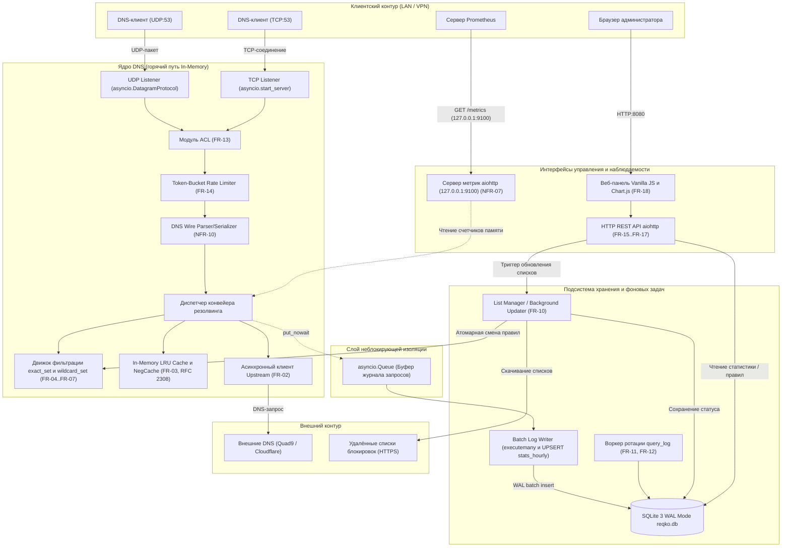
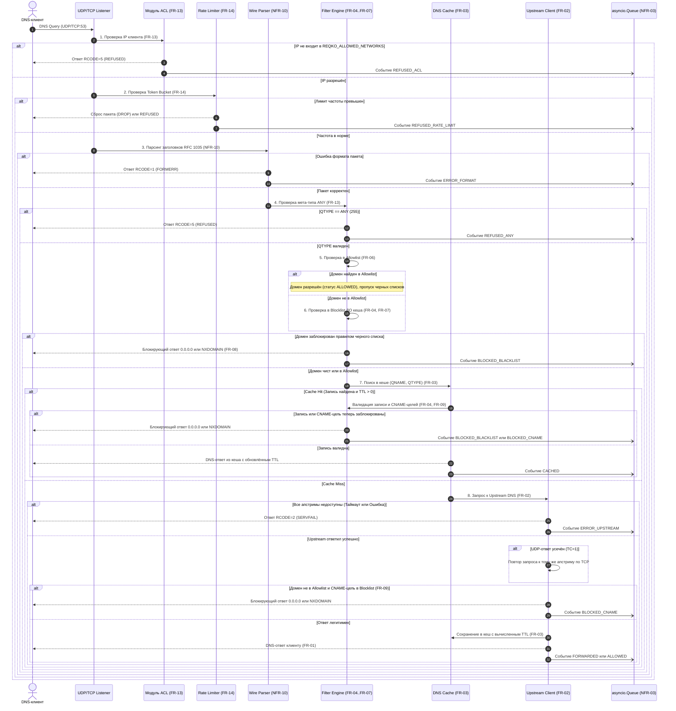
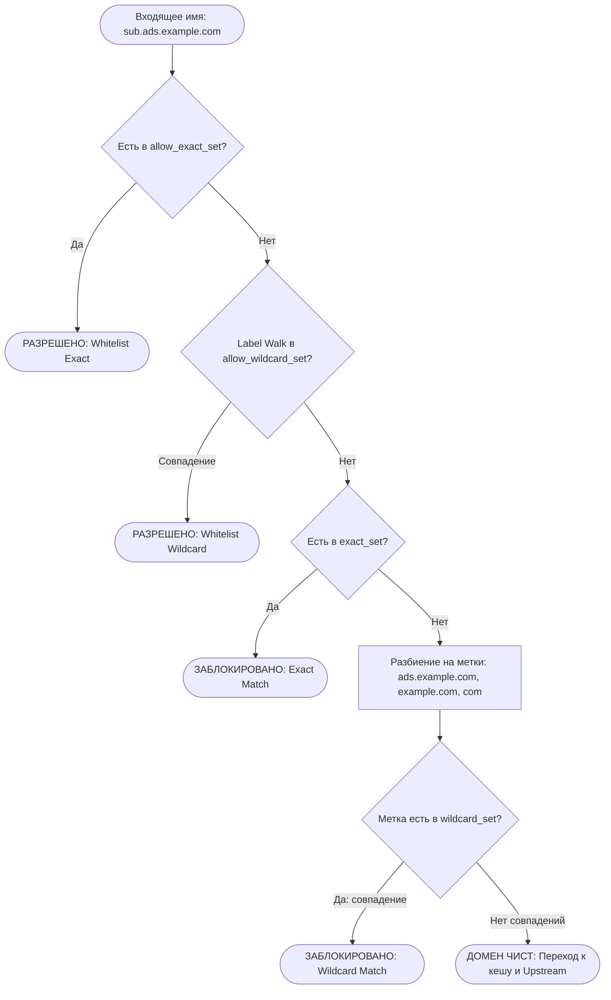
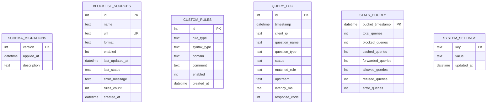

# Цель 3 — Архитектура и проектирование базы данных (ph-reqKO)

> Архитектурный документ к дипломному проекту  
> «Разработка DNS-сервера с фильтрацией рекламных и трекерных доменов и автоматизированным развёртыванием»  
> **Рабочее название проекта:** ph-reqKO (DNS-фильтр наподобие Pi-hole)  
> **Основание:** [docs/01-research.md](01-research.md), [docs/02-requirements.md](02-requirements.md)

---

## Содержание

1. [Обзор архитектуры и базовые принципы проектирования](#1-обзор-архитектуры-и-базовые-принципы-проектирования)
2. [Компонентная модель системы](#2-компонентная-модель-системы)
3. [Конвейер обработки DNS-запроса](#3-конвейер-обработки-dns-запроса)
4. [Модель многозадачности и изоляция сбоев](#4-модель-многозадачности-и-изоляция-сбоев)
5. [Структуры данных движка фильтрации](#5-структуры-данных-движка-фильтрации)
6. [Проектирование подсистемы кеширования](#6-проектирование-подсистемы-кеширования)
7. [Схема базы данных SQLite](#7-схема-базы-данных-sqlite)
8. [Спецификация REST API и веб-панели](#8-спецификация-rest-api-и-веб-панели)
9. [Конфигурация системы (переменные окружения)](#9-конфигурация-системы-переменные-окружения)
10. [Структура каталогов и пакетов проекта](#10-структура-каталогов-и-пакетов-проекта)
11. [Модель безопасности и нейтрализация угроз](#11-модель-безопасности-и-нейтрализация-угроз)
12. [Матрица трассируемости архитектуры к требованиям](#12-матрица-трассируемости-архитектуры-к-требованиям)
13. [Перечень принятых допущений и рисков для валидации в Цели 8](#13-перечень-принятых-допущений-и-рисков-для-валидации-в-цели-8)

---

## 1. Обзор архитектуры и базовые принципы проектирования

### 1.1. Назначение архитектуры
Архитектура **ph-reqKO** спроектирована в виде модульного пересылающего DNS-резолвера (Forwarding DNS Sinkhole) на языке Python с асинхронным сетевым циклом `asyncio`. Основное назначение — обеспечить минимальную задержку обслуживания сетевых запросов клиентов локальной сети, фильтрацию рекламных и трекерных доменов и предоставление интерфейсов управления и наблюдаемости без ущерба стабильности базовой сетевой инфраструктуры.

### 1.2. Фундаментальный принцип: полная изоляция горячего пути DNS (NFR-03)
Главный архитектурный принцип системы: **критический путь обработки DNS-запросов на порту 53 ни при каких обстоятельствах не зависит от работы базы данных, HTTP REST API, веб-панели или подсистемы сбора метрик**.

1. **Разрешение запросов строго из памяти**: Все структуры данных, необходимые для проверки списков контроля доступа (ACL), ограничения частоты (Rate Limiter), проверки правил блокировки (Filter Engine) и поиска в кеше (DNS Cache), размещаются исключительно в оперативной памяти (In-Memory).
2. **Неблокирующий сбор аналитики**: Фиксация истории запросов для базы данных SQLite отделена от горячего сетевого цикла через асинхронную очередь фиксированного размера (`asyncio.Queue`). Если СУБД SQLite заблокирована длительной операцией чтения, диск переполнен или процесс базы данных испытывает задержки, очередь переполняется, лог-событие отбрасывается с увеличением внутреннего счётчика, но клиенты продолжают получать ответы DNS без задержек.
3. **Изоляция сбоев API**: Сбой или перезапуск HTTP-сервера управления никак не прерывает прослушивание портов UDP/TCP 53.
4. **Атомарная смена правил фильтрации**: Обновление списков блокировок выполняется в фоновом воркере. Движок резолвера переключается на новый набор правил мгновенной атомарной сменой ссылки в памяти (Atomic Reference Swap) без захвата блокировок в цикле обработки запросов.

---

## 2. Компонентная модель системы

Архитектура системы разделена на независимые слои: транспортный уровень, конвейер фильтрации и кеширования, подсистему хранения и фоновых задач, а также уровень внешнего управления и мониторинга.



---

## 3. Конвейер обработки DNS-запроса

Обработка каждого входящего DNS-сообщения выполняется строго пошагово. При возникновении ошибок или срабатывании блокировок ответ формируется на самом раннем этапе без лишних накладных расходов.



### Поведение на каждом этапе конвейера при сбоях и таймаутах

| Порядок | Этап конвейера | Проверяемое условие / Сбой | Действие резолвера | Формируемый DNS-статус | Статус в query_log |
|:---:|---|---|---|---|---|
| **1** | **ACL (FR-13)** | Исходный IP не входит в `REQKO_ALLOWED_NETWORKS` | Немедленный возврат ответа с отказом, завершение обработки | `RCODE = 5 (REFUSED)` | `REFUSED_ACL` |
| **2** | **Rate Limiter (FR-14)** | Превышен порог запросов (Token Bucket per client IP) | Отбрасывание пакета (DROP) или ответ с отказом | Пакет отброшен / `REFUSED` | `REFUSED_RATE_LIMIT` |
| **3** | **Wire Parser (NFR-10)** | Повреждённый бинарный пакет DNS (нарушение RFC 1035) | Отклонение некорректного запроса, завершение обработки. Исходный IP-клиент известен из сетевого сокета/транспорта, поэтому событие логируется с реальным адресом | `RCODE = 1 (FORMERR)` | `ERROR_FORMAT` |
| **4** | **ANY Check (FR-13)** | Запрос мета-типа `QTYPE = 255 (ANY)` (DNS Amplification) | Отклонение запроса, завершение обработки | `RCODE = 5 (REFUSED)` | `REFUSED_ANY` |
| **5** | **Allowlist (FR-06)** | Домен совпал с правилом белого списка (`exact` или `@@\|\|`) | Пропуск проверки черных списков и CNAME-uncloaking | — | Статус `ALLOWED` |
| **6** | **Blocklist (FR-04, FR-07)** | Домен найден в `exact_set` или через Label Walk в `wildcard_set` | Формирование ответа по `REQKO_BLOCK_MODE`, завершение | `0.0.0.0` (NOERROR) или `NXDOMAIN` | `BLOCKED_BLACKLIST` |
| **7** | **Cache Lookup (FR-03)** | Найдена запись в кеше с `TTL > 0` (Cache Hit) | Ревалидация домена (FR-04) и CNAME-целей (FR-09) | Ответ из кеша (TTL актуализирован) | `CACHED` (или `BLOCKED_*`) |
| **8** | **Upstream (FR-02)** | Ответ по UDP содержит флаг усечения `TC = 1` | Повторный запрос к тому же upstream по протоколу TCP | — | — |
| **8** | **Upstream (FR-02)** | Таймаут основного upstream (`REQKO_UPSTREAM_TIMEOUT`) | Переключение на резервный (fallback) upstream | — | — |
| **8** | **Upstream (FR-02)** | Все сконфигурированные апстримы недоступны | Возврат ошибки сервера клиенту, завершение обработки | `RCODE = 2 (SERVFAIL)` | `ERROR_UPSTREAM` |
| **9** | **CNAME Uncloaking (FR-09)** | Upstream вернул CNAME на трекерный домен (если не в allowlist) | Подмена ответа на блокирующий по `REQKO_BLOCK_MODE` | `0.0.0.0` (NOERROR) или `NXDOMAIN` | `BLOCKED_CNAME` |
| **10** | **Cache Store (FR-03)** | Легитимный ответ от upstream | Сохранение в кеш (для NXDOMAIN/NODATA TTL по RFC 2308) | `NOERROR` / `NXDOMAIN` | `FORWARDED` / `ALLOWED` |
| **11** | **Log Queue (NFR-03)** | Очередь `asyncio.Queue` переполнена (диск перегружен) | Отбрасывание лога, инкремент `dns_dropped_logs_total` | Ответ клиенту **не задерживается** | Дроп события в буфере |

---

## 4. Модель многозадачности и изоляция сбоев

### 4.1. Архитектура циклов и корутин (asyncio)
Приложение выполняется в едином асинхронном цикле событий (Event Loop) процесса Python 3.11+:
1. **Корутина `dns_udp_server`**: обслуживает датаграммы UDP через `asyncio.DatagramProtocol`. Поскольку UDP не требует установления соединения, каждый пакет обрабатывается легковесной неблокирующей задачей.
2. **Корутина `dns_tcp_server`**: принимает соединения по TCP через `asyncio.start_server`. Каждое соединение обрабатывается отдельной асинхронной корутиной с контролем длины 2-байтного префикса длины DNS-пакета.
3. **Корутина `http_api_server`**: запускает встроенный веб-сервер API и статической веб-панели (порт 8080), а также отдельный сайт экспорта метрик Prometheus (порт 9100).
4. **Корутина `query_log_writer`**: фоновый воркер, который непрерывно читает элементы из `asyncio.Queue`, накапливает пачку (batch), сбрасывает её в SQLite через `executemany` и инкрементально обновляет счётчики таблицы `stats_hourly` через `UPSERT` в рамках той же транзакции.
5. **Корутина `retention_worker`**: периодическая задача (запуск раз в час), выполняющая исключительно очистку устаревших детальных записей таблицы `query_log` старше `REQKO_LOG_RETENTION_DAYS`.

### 4.2. Вынос блокирующих операций в пул потоков (ThreadPoolExecutor)
Синхронный блокирующий ввод-вывод и ресурсоёмкие вычисления категорически запрещено выполнять напрямую в event loop. Для них используется `loop.run_in_executor()`:
- **Операции с базой данных SQLite**: Модуль стандартной библиотеки `sqlite3` выполняет блокирующие дисковые системные вызовы. Все операции `executemany` и выборки для REST API делегируются в пул потоков с выделенным соединением для записи.
- **Парсинг больших списков блокировок (100k+ строк)**: Парсинг текстовых файлов hosts и списков правил (на машине разработки на Python 3.11 для 150 000 строк hosts занимает ~70 мс) выполняется в фоновом пуле потоков `ThreadPoolExecutor`, полностью устраняя блокировку цикла `asyncio`.

### 4.3. Атомарная смена правил в памяти (Atomic Reference Swap, FR-10)
Для исключения блокировок (locks) и гонок данных (race conditions) при обновлении списков блокировок применяется паттерн иммутабельного снимка состояния (Immutable Snapshot):

```python
# Концептуальная схема состояния в памяти
class FilterSnapshot:
    __slots__ = ('exact_set', 'wildcard_set', 'allow_exact_set', 'allow_wildcard_set', 'version', 'rules_count')
    def __init__(self, exact_set, wildcard_set, allow_exact_set, allow_wildcard_set, version, rules_count):
        self.exact_set: frozenset[str] = exact_set
        self.wildcard_set: frozenset[str] = wildcard_set
        self.allow_exact_set: frozenset[str] = allow_exact_set
        self.allow_wildcard_set: frozenset[str] = allow_wildcard_set
        self.version: int = version
        self.rules_count: int = rules_count

class FilterEngine:
    def __init__(self):
        self._snapshot = FilterSnapshot(frozenset(), frozenset(), frozenset(), frozenset(), 0, 0)

    def match(self, domain: str) -> tuple[bool, str]:
        # Чтение ссылки на снимок атомарно в CPython
        snap = self._snapshot
        # Далее поиск выполняется строго в неизменяемых множествах frozenset
        ...
```
- Фоновый воркер обновления скачивает новые списки, выполняет валидацию, парсит правила и собирает **новый** экземпляр `FilterSnapshot`.
- При успешном завершении сборки ссылка `self._snapshot = new_snapshot` атомарно подменяется (байт-код `STORE_ATTR` в CPython является неделимой операцией).
- Текущие активные DNS-запросы, начавшие проверку по старому снимку, успешно завершают её; все последующие запросы мгновенно используют новый набор правил.
- В случае сбоя парсинга или недоступности серверов списков старый снимок остаётся неизменным (fallback to last working list, FR-10).

---

## 5. Структуры данных движка фильтрации

### 5.1. Архитектура множеств и алгоритм Label Walk (FR-05..FR-07)
База правил в памяти организована в виде четырёх независимых хеш-множеств `frozenset[str]`:
1. `allow_exact_set`: Точные домены пользовательского белого списка.
2. `allow_wildcard_set`: Домены исключений синтаксиса `@@||domain^`.
3. `exact_set`: Точные домены из файлов `/etc/hosts` и простых плоских списков.
4. `wildcard_set`: Домены для блокировки поддеревьев из правил синтаксиса `||domain^`.

Все доменные имена при загрузке нормализуются: приводятся к нижнему регистру (lowercase), отсекается замыкающая точка (`.`), исключаются пробелы.



#### Алгоритм Label Walk:
1. Запрашиваемое имя: `sub.tracker.adnetwork.com`.
2. Шаг 1: `tracker.adnetwork.com` (проверка в `wildcard_set`).
3. Шаг 2: `adnetwork.com` (проверка в `wildcard_set` -> совпадение!).
4. Прекращение обхода, возвращается вердикт `BLOCKED`.
Число хеш-поисков строго ограничено числом меток домена (в подавляющем большинстве случаев глубина составляет 2–4 шага). Сложность поиска составляет $O(K)$, где $K$ — количество меток в запрашиваемом домене (константа $\le 5$).

### 5.2. Потребление памяти и сравнение с альтернативой Trie (NFR-02)
- **Хеш-множества (`frozenset`)**: На машине разработки (Linux x86_64, Python 3.10/3.11) множество `frozenset` для 150 000 синтетических доменов занимает ~6.0 МБ оперативной памяти (а суммарно со строками доменов — порядка 15–20 МБ) при времени построения ~21 мс (*измерено на машине разработчика, а не на целевом оборудовании Raspberry Pi; resident memory на целевом стенде будет валидироваться в Цели 8*). Это полностью укладывается в бюджет NFR-02 (200–350 МБ).
- **Альтернатива (Префиксное дерево / Trie)**: Для сравнения, в качестве альтернативы было протестировано префиксное дерево Trie на чистом Python: каждый узел представляет собой объект `TrieNode` со слотами `__slots__ = ('children', 'is_end')`, где метки доменов просматриваются от TLD к поддоменам (`com -> adnetwork -> sub`), а дочерние узлы хранятся в словарях `dict[str, TrieNode]`. На машине разработки для 150 000 доменов такая наивная структура на словарях потребовала 126.31 МБ оперативной памяти (в 21.1 раза больше памяти, чем `frozenset`) и ~1690 мс на построение. Воспроизводимый скрипт замеров доступен в [docs/benchmarks/memory_filter_structures.py](benchmarks/memory_filter_structures.py). Это подтверждает обоснованность выбора `frozenset + Label walk` для компактного размещения в оперативной памяти без внешних C-расширений.
- **Статус архитектурного решения**: Выбор `frozenset + Label walk` принимается в качестве базового проектного решения; замеры скорости сопоставления и потребления памяти на целевом Raspberry Pi 4 зафиксированы как **допущение, подлежащее валидации в Цели 8**.

---

## 6. Проектирование подсистемы кеширования

### 6.1. Ключ и структура записи кеша
Кеш размещается в оперативной памяти и строится на базе `collections.OrderedDict` для поддержки алгоритма вытеснения LRU (Least Recently Used).
- **Ключ кеша**: Кортеж `(qname_lower: str, qtype: int)`. Регистр нормализуется, тип запроса представляется целым числом (A=1, AAAA=28 и т.д.).
- **Структура элемента `CacheEntry`**:
  - `qname: str`: нормализованное запрашиваемое имя;
  - `qtype: int`: тип записи запроса;
  - `records: list[DNSRecord]`: список распарсенных ресурсных записей секций Answer/Authority/Additional;
  - `cname_targets: tuple[str, ...]`: кортеж всех целевых канонических имён из цепочки CNAME (для мгновенной повторной валидации по FR-09 без повторного парсинга бинарных байт ответа);
  - `response_code: int`: код возврата (0 для `NOERROR`, 3 для `NXDOMAIN`);
  - `created_at: float`: метка времени сохранения (`time.monotonic()`);
  - `expires_at: float`: метка времени истечения срока годности (`created_at + ttl`);
  - `is_negative: bool`: булев флаг негативного кеширования (RFC 2308);
  - `original_ttl: int`: исходный TTL записи, полученный от авторитетного сервера.

### 6.2. Обработка времени жизни (TTL), CNAME-приоритет и негативное кеширование (RFC 2308)
1. **Расчёт оставшегося TTL**:
   $$\text{remaining\_ttl} = \max(0, \text{int}(\text{entry.expires\_at} - \text{time.monotonic}()))$$
   Если $\text{remaining\_ttl} = 0$, запись считается протухшей, удаляется из кеша и обрабатывается как Cache Miss.
2. **Модификация ответа**: При формировании DNS-ответа из кеша поле TTL в заголовке каждой ресурсной записи переписывается значением $\text{remaining\_ttl}$.
3. **Ограничение экстремальных значений TTL**:
   - Минимальный порог (`REQKO_CACHE_MIN_TTL`, по умолчанию 60 с): предотвращает флуд запросами для сайтов с TTL = 0.
   - Максимальный порог (`REQKO_CACHE_MAX_TTL`, по умолчанию 86400 с / 24 часа): исключает вечное удержание устаревших записей при смене IP-адресов целевых сервисов.
4. **Приоритет белого списка над CNAME-фильтрацией (FR-06 vs FR-09)**:
   Если запрашиваемое доменное имя совпало с правилом белого списка (`allowlist`), проверка цепочки `cname_targets` на блокировку **пропускается**.
   *Обоснование*: Согласно FR-06, белый список имеет наивысший приоритет над любыми блокировками. Если пользователь явно добавил домен в исключения, блокировка его промежуточного CNAME привела бы к нарушению прямого указания администратора. Если же исходное имя не находится в белом списке, каждый элемент `cname_targets` обязан повторно валидироваться по правилам фильтрации (FR-09).
5. **Негативное кеширование (RFC 2308)**:
   Ответы `NXDOMAIN` (RCODE 3) и пустые ответы `NODATA` (NOERROR без секции Answer) кешируются строго по формуле RFC 2308 (раздел 3 и 5):
   $$\text{negative\_ttl} = \min(\text{SOA.TTL}, \text{SOA.MINIMUM})$$
   Если ресурсная запись `SOA` отсутствует в секции Authority ответа, используется безопасное значение по умолчанию 300 секунд. Это защищает upstream от повторного флуда несуществующими доменами.

### 6.3. Политика вытеснения (LRU) и лимиты
Размер кеша строго ограничен переменной `REQKO_CACHE_SIZE` (по умолчанию 10 000 записей; на машине разработки 10 000 записей `CacheEntry` занимают ~4.0 МБ памяти, что с запасом укладывается в бюджет памяти). При достижении максимального размера вызов `popitem(last=False)` немедленно вытесняет наименее востребованную запись.

---

## 7. Схема базы данных SQLite

### 7.1. ER-диаграмма связей
База данных SQLite (`reqko.db`) предназначена исключительно для хранения конфигурации списков, пользовательских исключений, агрегированной статистики и журнала запросов.



### 7.2. DDL-скрипт создания таблиц и индексов

```sql
PRAGMA foreign_keys = ON;

-- 1. Таблица версий схемы и истории миграций
CREATE TABLE IF NOT EXISTS schema_migrations (
    version INTEGER PRIMARY KEY,
    applied_at TIMESTAMP NOT NULL DEFAULT CURRENT_TIMESTAMP,
    description TEXT NOT NULL
);

-- 2. Таблица подключённых источников списков блокировок (FR-15)
CREATE TABLE IF NOT EXISTS blocklist_sources (
    id INTEGER PRIMARY KEY AUTOINCREMENT,
    name TEXT NOT NULL,
    url TEXT NOT NULL UNIQUE,
    format TEXT NOT NULL CHECK(format IN ('hosts', 'plain', 'abp')),
    enabled INTEGER NOT NULL DEFAULT 1 CHECK(enabled IN (0, 1)),
    last_updated_at TIMESTAMP,
    last_status TEXT CHECK(last_status IN ('success', 'error', 'pending')),
    error_message TEXT,
    rules_count INTEGER NOT NULL DEFAULT 0,
    created_at TIMESTAMP NOT NULL DEFAULT CURRENT_TIMESTAMP
);

-- 3. Таблица пользовательских исключений и блокировок (FR-19)
CREATE TABLE IF NOT EXISTS custom_rules (
    id INTEGER PRIMARY KEY AUTOINCREMENT,
    rule_type TEXT NOT NULL CHECK(rule_type IN ('whitelist', 'blacklist')),
    syntax_type TEXT NOT NULL CHECK(syntax_type IN ('exact', 'wildcard')),
    domain TEXT NOT NULL,
    comment TEXT,
    enabled INTEGER NOT NULL DEFAULT 1 CHECK(enabled IN (0, 1)),
    created_at TIMESTAMP NOT NULL DEFAULT CURRENT_TIMESTAMP,
    UNIQUE(rule_type, domain)
);

-- 4. Детальный журнал обработанных запросов (FR-11, FR-12)
CREATE TABLE IF NOT EXISTS query_log (
    id INTEGER PRIMARY KEY AUTOINCREMENT,
    timestamp TIMESTAMP NOT NULL DEFAULT CURRENT_TIMESTAMP,
    client_ip TEXT NOT NULL,
    question_name TEXT NOT NULL,
    question_type TEXT NOT NULL,
    status TEXT NOT NULL CHECK(status IN (
        'ALLOWED',
        'FORWARDED', 
        'BLOCKED_BLACKLIST', 
        'BLOCKED_CNAME', 
        'CACHED', 
        'REFUSED_ACL', 
        'REFUSED_RATE_LIMIT', 
        'REFUSED_ANY', 
        'ERROR_UPSTREAM',
        'ERROR_FORMAT'
    )),
    matched_rule TEXT,
    upstream TEXT,
    latency_ms REAL NOT NULL,
    response_code INTEGER NOT NULL
);

CREATE INDEX IF NOT EXISTS idx_query_log_timestamp ON query_log(timestamp);
CREATE INDEX IF NOT EXISTS idx_query_log_client_ip ON query_log(client_ip);
CREATE INDEX IF NOT EXISTS idx_query_log_question_name ON query_log(question_name);
CREATE INDEX IF NOT EXISTS idx_query_log_status ON query_log(status);

-- 5. Почасовая агрегированная статистика для быстрых графиков (FR-11, FR-18)
-- Сумма подкатегорий строго равна total_queries
CREATE TABLE IF NOT EXISTS stats_hourly (
    bucket_timestamp TIMESTAMP NOT NULL PRIMARY KEY,
    total_queries INTEGER NOT NULL DEFAULT 0,
    blocked_queries INTEGER NOT NULL DEFAULT 0,
    cached_queries INTEGER NOT NULL DEFAULT 0,
    forwarded_queries INTEGER NOT NULL DEFAULT 0,
    allowed_queries INTEGER NOT NULL DEFAULT 0,
    refused_queries INTEGER NOT NULL DEFAULT 0,
    error_queries INTEGER NOT NULL DEFAULT 0
);

-- 6. Таблица параметров и настроек
CREATE TABLE IF NOT EXISTS system_settings (
    key TEXT PRIMARY KEY,
    value TEXT NOT NULL,
    updated_at TIMESTAMP NOT NULL DEFAULT CURRENT_TIMESTAMP
);
```

### 7.3. Конфигурация WAL и стратегия пакетной записи (Batch Insert & UPSERT)
Для устранения взаимных блокировок при одновременном чтении API и записи логов подключение к SQLite настраивается прагмами:
```sql
PRAGMA journal_mode = WAL;
PRAGMA synchronous = NORMAL;
PRAGMA busy_timeout = 5000;
PRAGMA cache_size = -64000; -- Выделение до 64 МБ оперативной памяти под страницу кеша SQLite
```
- **Инкрементальный UPSERT в единой транзакции**: Воркер `query_log_writer` накапливает события из `asyncio.Queue` до достижения пачки в 100 записей либо по таймауту 2.0 секунды. Внутри единой транзакции `BEGIN TRANSACTION ... COMMIT` выполняются:
  1. Пакетная вставка в детальный журнал: `cursor.executemany("INSERT INTO query_log ...", batch)`.
  2. Инкрементальное обновление почасовых счётчиков `stats_hourly` через механизм `UPSERT`:
     ```sql
     INSERT INTO stats_hourly (
         bucket_timestamp, total_queries, blocked_queries, cached_queries,
         forwarded_queries, allowed_queries, refused_queries, error_queries
     ) VALUES (?, ?, ?, ?, ?, ?, ?, ?)
     ON CONFLICT(bucket_timestamp) DO UPDATE SET
         total_queries = total_queries + excluded.total_queries,
         blocked_queries = blocked_queries + excluded.blocked_queries,
         cached_queries = cached_queries + excluded.cached_queries,
         forwarded_queries = forwarded_queries + excluded.forwarded_queries,
         allowed_queries = allowed_queries + excluded.allowed_queries,
         refused_queries = refused_queries + excluded.refused_queries,
         error_queries = error_queries + excluded.error_queries;
     ```
  **Правило подсчёта подкатегорий**:
  - `blocked_queries`: события `BLOCKED_BLACKLIST`, `BLOCKED_CNAME`;
  - `cached_queries`: события `CACHED`;
  - `forwarded_queries`: события `FORWARDED`;
  - `allowed_queries`: события `ALLOWED` (разрешено по белому списку, FR-06);
  - `refused_queries`: события `REFUSED_ACL`, `REFUSED_RATE_LIMIT`, `REFUSED_ANY`;
  - `error_queries`: события сбоев `ERROR_UPSTREAM` и `ERROR_FORMAT`.
  Сумма значений всех 6 подкатегорий строго равна `total_queries`. Это гарантирует мгновенную актуальность почасовой аналитики без необходимости тяжёлых фоновых сканирований таблицы `query_log`.

### 7.4. Ротация логов и анонимизация IP-адресов (FR-12)
1. **Анонимизация IP**: Если в конфигурации активирована опция `REQKO_ANONYMIZE_IPS=true`, воркер записи перед вставкой в БД модифицирует клиентский IP:
   - Для IPv4 (`192.168.1.45`) последний октет заменяется на `0` (`192.168.1.0`).
   - Для IPv6 сохраняется только префикс сети `/64` (хостовая часть обнуляется).
2. **Воркер ротации (Retention Worker)**: Раз в час запускается фоновая корутина, которая выполняет исключительно удаление устаревших детальных записей старше `REQKO_LOG_RETENTION_DAYS`:
   ```sql
   DELETE FROM query_log WHERE timestamp < datetime('now', '-' || ? || ' days');
   ```
   Поскольку таблица `stats_hourly` уже инкрементально наполнена воркером записи, исторические графики за недели и месяцы остаются доступными в веб-панели даже после удаления устаревших строк из `query_log`.

---

## 8. Спецификация REST API и веб-панели

### 8.1. Разграничение доступа к маршрутам (FR-16, FR-17)
В качестве легковесного веб-фреймворка выбран **aiohttp** (нативный асинхронный HTTP-стек для `asyncio`, не требующий сторонних ASGI-серверов вроде uvicorn и дополнительных зависимостей).

Поскольку один экземпляр HTTP-сервера в `aiohttp` не может привязывать отдельные маршруты к разным сетевым интерфейсам, система разделяет веб-интерфейс на два независимых сайта (aiohttp sites):
1. **Основной HTTP API и веб-панель** (слушает `REQKO_HTTP_HOST:REQKO_HTTP_PORT`, по умолчанию `0.0.0.0:8080`):
   - **Общедоступные эндпоинты (без аутентификации)**:
     - `GET /health` — проверка работоспособности процесса (liveness probe для Docker `HEALTHCHECK`);
     - `GET /ready` — проверка готовности резолвера (readiness probe: правила загружены в память, сетевые слушатели активны);
     - `GET /` — отдача статической HTML/JS веб-панели.
   - **Приватные эндпоинты управления (`/api/v1/*`)**:
     - Требуют обязательной передачи заголовка: `X-API-Key: <REQKO_API_KEY>`. При отсутствии или неверном ключе возвращается статус `401 Unauthorized`.
     - **Политика безопасности запуска**: Сервер ph-reqKO **отказывается запускаться без явного указания `REQKO_API_KEY`** (значение по умолчанию отсутствует; в dev-режиме при первом старте возможна автоматическая генерация стойкого ключа с однократным выводом в stdout и сохранением его безопасного хеша).
   - HTTP-сервер также проверяет IP-клиента по доверенным подсетям `REQKO_ALLOWED_NETWORKS`.
2. **Выделенный сайт метрик Prometheus** (слушает `REQKO_METRICS_HOST:REQKO_METRICS_PORT`, по умолчанию `127.0.0.1:9100`):
   - `GET /metrics` — изолирован на интерфейсе loopback и доступен без ключа только локальным процессам хоста. Основное API-приложение маршрут `/metrics` не обслуживает.
   - **Взаимодействие с Prometheus в Docker Compose**: При развёртывании с `network_mode: host` контейнер Prometheus также запускается с `network_mode: host` и скрейпит `http://127.0.0.1:9100/metrics`. В качестве альтернативы `REQKO_METRICS_HOST` может быть привязан к адресу внутреннего моста Docker с фильтрацией по `REQKO_ALLOWED_NETWORKS`. Окончательный вариант топологии будет зафиксирован при контейнеризации в Цели 6.

### 8.2. Таблица эндпоинтов

#### Основной HTTP REST API (`REQKO_HTTP_HOST:REQKO_HTTP_PORT`, порт 8080)

| Метод | Путь | Аутентификация | Назначение (FR) | Коды ответа |
|---|---|:---:|---|:---:|
| `GET` | `/health` | Нет | Liveness probe для Docker (FR-16) | 200, 503 |
| `GET` | `/ready` | Нет | Readiness probe (списки загружены) (FR-16) | 200, 503 |
| `GET` | `/api/v1/stats/summary` | `X-API-Key` | Сводка: всего запросов, заблокировано, % (FR-15) | 200, 401 |
| `GET` | `/api/v1/stats/top-blocked` | `X-API-Key` | Топ заблокированных доменов (FR-15) | 200, 401 |
| `GET` | `/api/v1/stats/top-clients` | `X-API-Key` | Топ активных клиентов сети (FR-11) | 200, 401 |
| `GET` | `/api/v1/stats/history` | `X-API-Key` | Временные ряды для графиков (FR-15, FR-18) | 200, 401 |
| `GET` | `/api/v1/querylog` | `X-API-Key` | Пагинированный список последних запросов (FR-11) | 200, 401 |
| `GET` | `/api/v1/lists` | `X-API-Key` | Список подключённых blocklist-источников (FR-15) | 200, 401 |
| `POST`| `/api/v1/lists` | `X-API-Key` | Добавление нового источника списков (FR-15) | 201, 400, 401 |
| `DELETE`| `/api/v1/lists/{id}`| `X-API-Key` | Удаление источника списков (FR-15) | 200, 401, 404 |
| `POST`| `/api/v1/lists/update`| `X-API-Key` | Принудительное обновление всех списков (FR-10, FR-15) | 202, 401 |
| `GET` | `/api/v1/rules/custom`| `X-API-Key` | Список ручных правил (FR-19) | 200, 401 |
| `POST`| `/api/v1/rules/custom`| `X-API-Key` | Добавление правила в whitelist/blacklist (FR-19) | 201, 400, 401 |
| `DELETE`| `/api/v1/rules/custom/{id}`| `X-API-Key` | Удаление пользовательского правила (FR-19) | 200, 401, 404 |

#### Выделенный сервер метрик (`REQKO_METRICS_HOST:REQKO_METRICS_PORT`, порт 9100)

| Метод | Путь | Хост и Порт | Аутентификация | Назначение (FR) | Коды ответа |
|---|---|---|:---:|---|:---:|
| `GET` | `/metrics` | `127.0.0.1:9100` | Доступ по IP (Loopback) | Экспорт метрик Prometheus (NFR-07) | 200, 403 |

### 8.3. Примеры запросов и ответов

#### 1. Проверка состояния (`GET /health`)
```http
GET /health HTTP/1.1
Host: localhost:8080
```
```http
HTTP/1.1 200 OK
Content-Type: application/json

{
  "status": "ok",
  "uptime_seconds": 3600
}
```

#### 2. Сводка статистики (`GET /api/v1/stats/summary`)
```http
GET /api/v1/stats/summary HTTP/1.1
Host: localhost:8080
X-API-Key: my-secure-random-token-2026
```
```http
HTTP/1.1 200 OK
Content-Type: application/json

{
  "total_queries": 14250,
  "blocked_queries": 3280,
  "blocked_percentage": 23.02,
  "cached_queries": 6120,
  "forwarded_queries": 4500,
  "allowed_queries": 350,
  "refused_queries": 0,
  "error_queries": 0,
  "active_rules_count": 148200,
  "last_lists_update": "2026-10-30T10:00:00Z"
}
```

#### 3. Добавление пользовательского правила (`POST /api/v1/rules/custom`)
```http
POST /api/v1/rules/custom HTTP/1.1
Host: localhost:8080
X-API-Key: my-secure-random-token-2026
Content-Type: application/json

{
  "rule_type": "whitelist",
  "syntax_type": "wildcard",
  "domain": "example-cdn.com",
  "comment": "Разрешить служебный CDN"
}
```
```http
HTTP/1.1 201 Created
Content-Type: application/json

{
  "id": 12,
  "status": "created",
  "rule": {
    "rule_type": "whitelist",
    "syntax_type": "wildcard",
    "domain": "example-cdn.com"
  }
}
```

### 8.4. Минималистичная веб-панель (FR-18)
Веб-интерфейс отдаётся сервером aiohttp по корневому маршруту `GET /` в виде статического HTML/CSS/JS файла.
- **Полная автономность (Offline-Ready)**: Библиотека `Chart.js` сохраняется локально в репозитории (`src/reqko/api/static/vendor/chart.umd.js`), что исключает обращение к сторонним CDN и гарантирует работу панели в закрытом LAN-сегменте без внешнего интернета.
- **Авторизация в браузере**: При первом открытии веб-панель отображает диалоговое окно ввода `API Key`, сохраняя его в `localStorage` браузера и автоматически подставляя в заголовок `X-API-Key` при последующих AJAX-запросах.

---

## 9. Конфигурация системы (переменные окружения)

Все параметры конфигурируются через переменные окружения с обязательным префиксом `REQKO_` (или файл `.env` при развёртывании через Docker Compose):

| Переменная | Тип | По умолчанию | Описание и валидация |
|---|---|---|---|
| `REQKO_DNS_HOST` | `str` | `0.0.0.0` | Сетевой адрес прослушивания входящих DNS-запросов |
| `REQKO_DNS_PORT` | `int` | `53` | Стандартный сетевой порт DNS (UDP и TCP) |
| `REQKO_HTTP_HOST` | `str` | `0.0.0.0` | Сетевой адрес прослушивания REST API и веб-панели |
| `REQKO_HTTP_PORT` | `int` | `8080` | Сетевой порт REST API и веб-панели |
| `REQKO_METRICS_HOST` | `str` | `127.0.0.1` | Сетевой интерфейс для эндпоинта `/metrics` (изоляция от общей LAN) |
| `REQKO_METRICS_PORT` | `int` | `9100` | Сетевой порт выделенного сервера метрик Prometheus |
| `REQKO_API_KEY` | `str` | *(нет / обязателен)* | Секретный токен доступа к REST API (`X-API-Key`). Сервер не запускается без ключа |
| `REQKO_UPSTREAM_DNS` | `str` | `9.9.9.9:53,149.112.112.112:53` | Список upstream DNS через запятую (основной и резервные) |
| `REQKO_UPSTREAM_TIMEOUT` | `float` | `2.0` | Таймаут ожидания ответа от upstream в секундах |
| `REQKO_BLOCK_MODE` | `str` | `NULL` | Режим блокировки: `NULL` (`0.0.0.0`/`::`), `NXDOMAIN`, `NODATA` |
| `REQKO_ALLOWED_NETWORKS` | `str` | `127.0.0.0/8,10.0.0.0/8,172.16.0.0/12,192.168.0.0/16,::1/128,fe80::/10` | Разрешённые подсети клиентов (ACL). Подсети VPN добавляются сюда |
| `REQKO_RATE_LIMIT_RPS` | `int` | `100` | Средний лимит запросов в секунду на один IP-клиент |
| `REQKO_RATE_LIMIT_BURST` | `int` | `150` | Максимальный всплеск (burst) в алгоритме Token Bucket |
| `REQKO_MAX_TCP_CONNECTIONS` | `int` | `100` | Максимальное число одновременных TCP-соединений клиентов |
| `REQKO_TCP_IDLE_TIMEOUT` | `float` | `5.0` | Таймаут разрыва неактивных входящих TCP-соединений (секунды) |
| `REQKO_CACHE_SIZE` | `int` | `10000` | Максимальное количество записей в LRU-кеше в памяти |
| `REQKO_CACHE_MIN_TTL` | `int` | `60` | Минимальный допустимый TTL в секундах |
| `REQKO_CACHE_MAX_TTL` | `int` | `86400` | Максимальный допустимый TTL в секундах (24 часа) |
| `REQKO_ANONYMIZE_IPS` | `bool` | `false` | Маскирование клиентских IP в логах (`true` / `false`) |
| `REQKO_LOG_RETENTION_DAYS` | `int` | `30` | Срок хранения детального журнала в днях |
| `REQKO_DB_PATH` | `str` | `/data/reqko.db` | Путь к файлу базы данных SQLite на диске |
| `REQKO_LOG_LEVEL` | `str` | `INFO` | Уровень логирования процесса (`DEBUG`, `INFO`, `WARNING`, `ERROR`) |

---

## 10. Структура каталогов и пакетов проекта

Архитектура файловой структуры спроектирована по современным стандартам упаковки Python (`pyproject.toml`, layout `src/`), при этом манифест `docker-compose.yml` расположен непосредственно в корне репозитория для выполнения критерия приёмки NFR-08:

```
ph-reqko/
├── docker-compose.yml                # Базовый манифест запуска стека (в корне проекта, NFR-08)
├── docker-compose.override.yml       # Локальные оверрайды для разработки
├── pyproject.toml                    # Метаданные пакета, зависимости (aiohttp) и конфиг линтеров
├── README.md                         # Описание проекта и инструкция по запуску
├── src/
│   └── reqko/
│       ├── __init__.py               # Версия пакета
│       ├── __main__.py               # Точка входа для запуска (python -m reqko)
│       ├── config.py                 # Валидация и загрузка настроек из REQKO_*
│       ├── dns/
│       │   ├── __init__.py
│       │   ├── server.py             # Слушатели UDP (DatagramProtocol) и TCP
│       │   ├── protocol.py           # Парсер и упаковщик DNS-пакетов (RFC 1035)
│       │   ├── pipeline.py           # Диспетчер конвейера обработки запроса
│       │   ├── acl.py                # Проверка клиентских IP по REQKO_ALLOWED_NETWORKS
│       │   ├── ratelimit.py          # Token-Bucket per-client rate limiter
│       │   ├── upstream.py           # Асинхронный клиент пересылки на Upstream DNS
│       │   └── cache.py              # LRU-кеш в памяти + NegCache (RFC 2308)
│       ├── filtering/
│       │   ├── __init__.py
│       │   ├── engine.py             # exact_set + wildcard_set + Label Walk
│       │   ├── parser.py             # Парсер форматов hosts, plain и ABP (||, @@)
│       │   └── updater.py            # Воркер обновления и атомарной подмены снимка
│       ├── storage/
│       │   ├── __init__.py
│       │   ├── database.py           # Менеджер SQLite (WAL, прагмы, пулы)
│       │   ├── migrations.py         # Выполнение DDL-миграций схемы
│       │   ├── logger.py             # Асинхронный буфер (Queue -> batch executemany & UPSERT)
│       │   └── retention.py          # Воркер очистки устаревших логов
│       ├── api/
│       │   ├── __init__.py
│       │   ├── server.py             # HTTP-сервер на базе aiohttp
│       │   ├── routes.py             # Маршруты REST API (/api/v1, /health, /ready, /metrics)
│       │   ├── auth.py               # Middleware проверки X-API-Key и REQKO_ALLOWED_NETWORKS
│       │   └── static/               # Статические файлы веб-панели
│       │       ├── index.html        # HTML-интерфейс
│       │       ├── app.js            # Логика запросов к API и отрисовки графиков
│       │       ├── style.css         # Стили оформления
│       │       └── vendor/           # Локальные вендорные библиотеки
│       │           └── chart.umd.js  # Автономная библиотека Chart.js (offline)
│       └── metrics/
│           ├── __init__.py
│           └── exporter.py           # Экспорт метрик Prometheus (/metrics)
├── tests/
│   ├── unit/
│   │   ├── test_dns_protocol.py      # Тесты парсинга RFC 1035 wire format
│   │   ├── test_filter_engine.py     # Тесты правил exact, wildcard, allowlist
│   │   ├── test_cache.py             # Тесты TTL, LRU, CNAME-revalidation
│   │   ├── test_acl.py               # Тесты валидации доверенных подсетей
│   │   └── test_ratelimit.py         # Тесты алгоритма Token Bucket
│   ├── integration/
│   │   ├── test_pipeline.py          # Сквозное тестирование цепочки резолвинга
│   │   ├── test_api.py               # Тесты маршрутов REST API и авторизации
│   │   └── test_storage.py           # Тесты batch-записи и ротации логов SQLite
│   └── conftest.py                   # Фикстуры pytest
├── docker/
│   ├── Dockerfile                    # Multi-stage сборка non-root контейнера
│   └── reverse-proxy/                # Конфигурация Nginx/Caddy с TLS и auth
│       ├── nginx.conf
│       └── conf.d/default.conf
├── docs/
│   ├── 01-research.md                # Исследовательский документ (Цель 1)
│   ├── 02-requirements.md            # Требования к системе (Цель 2)
│   └── 03-architecture.md            # Настоящий архитектурный документ (Цель 3)
└── .github/
    └── workflows/
        └── ci.yml                    # Автоматический пайплайн CI (ruff, mypy, pytest)
```

---

## 11. Модель безопасности и нейтрализация угроз

Модель безопасности разработана в соответствии с требованиями **NFR-04** и покрывает ключевые векторы сетевых и прикладных атак:

| Угроза / Вектор атаки | Описание риска | Архитектурная мера нейтрализации | Соответствие требованию |
|---|---|---|:---:|
| **DNS Amplification Attack** | Использование сервера в качестве отражателя для DDoS-атак с подделкой IP жертвы | 1. Запросы от сетей вне `REQKO_ALLOWED_NETWORKS` отклоняются со статусом `REFUSED`.<br>2. Запросы типа `ANY` (QTYPE=255) отклоняются со статусом `REFUSED`.<br>3. Включение per-client rate limiting (Token Bucket). | FR-13, FR-14, NFR-04 |
| **DNS Cache Poisoning** | Внедрение поддельных записей в локальный кеш через подбор ID запроса (Kaminsky-style) | 1. Использование случайных 16-битных идентификаторов `Query ID` для каждого запроса к upstream.<br>2. Выделение свежего сокета со случайным эфемерным портом ОС на каждый запрос к upstream.<br>3. Строгая валидация ответа upstream: соответствие ID, совпадение секции Question (домен и тип) и удалённого адреса/порта.<br>4. Игнорирование несвязанных записей в секциях Authority и Additional (проектный выбор для исключения посторонних инъекций). | NFR-04, NFR-10 |
| **Усечение UDP-ответов (DNS Truncation)** | Потеря данных при больших ответах upstream по протоколу UDP | При получении UDP-пакета с установленным битом `TC = 1` клиент upstream немедленно выполняет повторный запрос по протоколу TCP. | FR-01, FR-02, NFR-10 |
| **TCP Connection Exhaustion / Slowloris** | Исчерпание дескрипторов сокетов и памяти медленными TCP-клиентами | Ограничение максимального количества одновременных TCP-клиентов (`REQKO_MAX_TCP_CONNECTIONS`, по умолчанию 100) и принудительный разрыв неактивных соединений по таймауту (`REQKO_TCP_IDLE_TIMEOUT`, по умолчанию 5.0 с). | NFR-03, NFR-04 |
| **Несанкционированный доступ к API** | Изменение списков блокировки или просмотр истории сетевой активности третьими лицами | Обязательная проверка заголовка `X-API-Key` на всех эндпоинтах `/api/v1/*`. Сервер не стартует без ключа. Изоляция `/metrics` на выделенном локальном сервере `REQKO_METRICS_HOST:REQKO_METRICS_PORT` (`127.0.0.1:9100`). Терминация TLS через обратный прокси при удалённом доступе. | FR-17, NFR-04, NFR-08 |
| **Path Traversal при загрузке списков** | Попытка чтения произвольных файлов хоста через передачу локальных путей вместо URL | Разрешены только схемы `http://` и `https://`. Для локальных списков путь нормализуется через `os.path.abspath()` с проверкой вхождения в разрешённую директорию `/data/lists/`. | NFR-04 |
| **SQL-инъекции (SQLi)** | Передача вредоносного доменного имени или заголовка для инъекции команд в SQLite | Абсолютный запрет конкатенации строк при формировании SQL-запросов. Все операции выполняются исключительно через параметризованные запросы (`?`). | NFR-04 |
| **DoS-атака на порт управления** | Флуд HTTP-запросами к веб-интерфейсу | Изоляция HTTP-сервера от критического DNS-резолвера; лимиты размера тела запроса (max body size = 1 МБ), ограничение входящих подсетей по `REQKO_ALLOWED_NETWORKS`. | NFR-03, NFR-04 |
| **Компрометация хоста через контейнер** | Эксплуатация уязвимости процесса для получения прав root на сервере | Запуск контейнера от выделенного непривилегированного пользователя `reqko` (UID 10001) без прав root с предоставлением минимального `CAP_NET_BIND_SERVICE`. | NFR-04 |

---

## 12. Матрица трассируемости архитектуры к требованиям

Таблица демонстрирует покрытие всех 19 функциональных требований (FR) и 10 нефункциональных требований (NFR) компонентами и разделами архитектуры:

| Идентификатор | Название требования | Статус MoSCoW | Раздел архитектуры | Компонент реализации в кодовой базе |
|---|---|:---:|:---:|---|
| **FR-01** | Приём DNS по UDP и TCP (RFC 1035) | **Must** | Разд. 2, 3, 4.1 | `src/reqko/dns/server.py` |
| **FR-02** | Пересылка запросов на Upstream DNS | **Must** | Разд. 2, 3 | `src/reqko/dns/upstream.py` |
| **FR-03** | Локальное кеширование с учётом TTL | **Must** | Разд. 3, 6 | `src/reqko/dns/cache.py` |
| **FR-04** | Фильтрация ДО кеша и валидация кеша | **Must** | Разд. 3, 5.1 | `src/reqko/dns/pipeline.py`, `filtering/engine.py` |
| **FR-05** | Форматы hosts, plain и ABP (`\|\|`, `@@`) | **Must** | Разд. 5.1 | `src/reqko/filtering/parser.py` |
| **FR-06** | Приоритет Allowlist над Blocklist | **Must** | Разд. 3, 5.1 | `src/reqko/filtering/engine.py` |
| **FR-07** | Сопоставление поддоменов (`\|\|domain^`) | **Must** | Разд. 5.1 | `src/reqko/filtering/engine.py` (Label Walk) |
| **FR-08** | Конфигурируемый ответ (`0.0.0.0`, NXDOMAIN) | **Must** | Разд. 3, 9 | `src/reqko/dns/pipeline.py` |
| **FR-09** | CNAME-uncloaking и кеш | **Should** | Разд. 3, 6 | `src/reqko/dns/pipeline.py` |
| **FR-10** | Отказоустойчивое обновление списков | **Must** | Разд. 4.3 | `src/reqko/filtering/updater.py` (Atomic Swap) |
| **FR-11** | Логирование запросов и статистика | **Must** | Разд. 4.1, 7 | `src/reqko/storage/logger.py`, `database.py` |
| **FR-12** | Срок хранения логов и анонимизация IP | **Should** | Разд. 7.4 | `src/reqko/storage/retention.py`, `logger.py` |
| **FR-13** | Ограничение сетей (ACL) и отказ в ANY | **Must** | Разд. 3, 11 | `src/reqko/dns/acl.py` |
| **FR-14** | Ограничение частоты (Rate Limiting) | **Should** | Разд. 3, 11 | `src/reqko/dns/ratelimit.py` (Token Bucket) |
| **FR-15** | REST API управления и метрик | **Must** | Разд. 8 | `src/reqko/api/routes.py`, `server.py` |
| **FR-16** | Health Check (`/health`, `/ready`) | **Must** | Разд. 8.1 | `src/reqko/api/routes.py` |
| **FR-17** | Аутентификация REST API (`X-API-Key`) | **Must** | Разд. 8.1 | `src/reqko/api/auth.py` |
| **FR-18** | Минималистичная панель с графиками | **Should** | Разд. 8.4 | `src/reqko/api/static/index.html`, `app.js` |
| **FR-19** | Ручные пользовательские правила | **Should** | Разд. 7.2, 8.2 | `src/reqko/api/routes.py`, `storage/database.py` |
| **NFR-01** | Задержка p95 < 10–15 мс (кеш) | **Should** | Разд. 1.2, 6 | In-memory кеш и структуры frozenset |
| **NFR-02** | Потребление RAM < 200–350 МБ | **Should** | Разд. 5.2 | Компактные frozenset, лимит LRU-кеша |
| **NFR-03** | Отказоустойчивость и изоляция сбоев | **Must** | Разд. 1.2, 4 | Асинхронная очередь `asyncio.Queue` |
| **NFR-04** | Безопасность сетевого контура | **Must** | Разд. 11 | Non-root контейнер, ACL, rate limit, bind service |
| **NFR-05** | Качество кода (PEP 8, mypy, ruff) | **Must** | Разд. 10 | Типизация Python 3.11+, строгий mypy, CI |
| **NFR-06** | Мультиплатформенность (AMD64/ARM64) | **Could** | Разд. 1.1, 10 | Чистый `asyncio` без обязательных C-расширений |
| **NFR-07** | Наблюдаемость (Prometheus/Grafana) | **Should** | Разд. 2, 8.1 | `src/reqko/metrics/exporter.py` (`/metrics`) |
| **NFR-08** | Автоматизированное развёртывание | **Must** | Разд. 10 | `docker-compose.yml`, reverse proxy профиль |
| **NFR-09** | Тестируемость и CI (> 70% coverage) | **Should** | Разд. 10 | `tests/unit`, `tests/integration`, GitHub Actions |
| **NFR-10** | Соответствие RFC 1034 / RFC 1035 | **Must** | Разд. 3, 11 | `src/reqko/dns/protocol.py` (сжатие меток 0xC0) |

---

## 13. Перечень принятых допущений и рисков для валидации в Цели 8

Все архитектурные решения, основанные на теоретических оценках и допущениях без эмпирических замеров на текущем этапе, классифицированы как **допущения**, подлежащие экспериментальной валидации в Цели 8:

1. **Допущение о сохранении Client Source IP в Docker**: Принимается предположение, что режим сети `network_mode: host` (на хостах Linux) или `macvlan` полностью сохраняет исходный реальный IP-адрес клиента без подмены его на адрес шлюза bridge-сети (userland-proxy). Корректность работы ACL (FR-13), rate limiting (FR-14) и статистики по клиентам (FR-11) в контейнере будет экспериментально проверена на реальном стенде в Целях 6 и 8.
2. **Допущение о производительности алгоритма Label Walk против Trie**: Предполагается, что обход по множествам `frozenset` для типичных доменов глубиной 2–4 метки требует единицы микросекунд и выигрывает у чистого Python-Trie по потреблению памяти примерно в 20 раз (на стенде разработчика для наивного Trie на словарях зафиксировано соотношение ~21.1x с оговоркой, что точный выигрыш зависит от архитектуры узлов дерева). Точные замеры latency и resident memory footprint на целевом Raspberry Pi 4 будут проведены в бенчмарках Цели 8.
3. **Допущение об устойчивости SQLite WAL при нагрузке**: Предполагается, что буферизация вставки логов пачками раз в 2 секунды полностью устранит contention базы данных и исключит ошибки `database is locked` при одновременной нагрузке до 100–300 QPS и активном скрейпинге REST API.
4. **Допущение о пропускной способности чистого asyncio**: Предполагается, что стандартный цикл событий `asyncio` на Python 3.11+ способен обрабатывать целевые 100–300 QPS на одном ядре процессора класса Raspberry Pi 4 / современного x86_64 CPU с задержкой p95 < 15 мс без обязательного подключения C-библиотеки `uvloop`.
5. **Допущение о потреблении памяти процессом**: Предполагается, что суммарное потребление памяти Python-процессом при 150 000 правил в памяти и кеше на 10 000 записей не превысит 200–350 МБ (NFR-02). Профилирование памяти с помощью `tracemalloc` / `memory_profiler` запланировано в рамках Цели 8.
