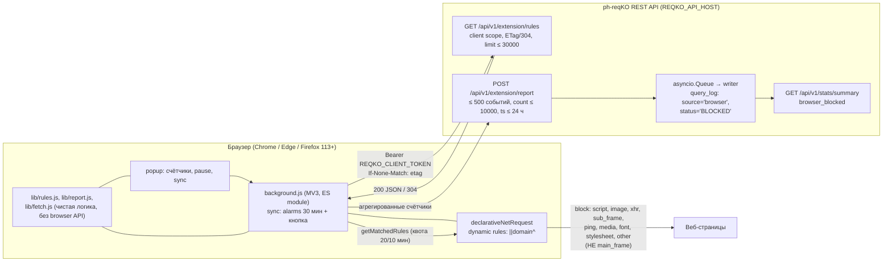

# Цель 6 (дополнение): Браузерное расширение ph-reqKO

> Расширение блокирует рекламные и трекерные домены в браузере по спискам вашего собственного сервера ph-reqKO — без изменения системного DNS. Основание: [docs/02-requirements.md](02-requirements.md), [docs/03-architecture.md](03-architecture.md); серверная часть — [docs/05-implementation.md](05-implementation.md) (REST API, Цель 5).

---

## 1. Назначение и связь с DNS-ядром

DNS-резолвер ph-reqKO блокирует домены для всей сети, но браузеры могут обходить его (DoH, ручной DNS), а устройство может быть вне сети сервера. Расширение закрывает эту дыру: оно забирает **тот же самый** список блокировок у REST API сервера и блокирует запросы средствами `declarativeNetRequest` прямо в браузере. Отчёты о заблокированных доменах возвращаются на сервер и попадают в общую статистику (`query_log` со `source='browser'`).

Приоритет allowlist соблюдён на стороне сервера: домены из белого списка **исключаются** из выгрузки (`/extension/rules`), поэтому расширение никогда не блокирует разрешённое.



*Диаграмма не валидировалась `mmdc` (инструмент отсутствует на машине).*

## 2. Официальные ограничения платформ (проверено по документации, не по памяти)

| Параметр | Chrome | Firefox | Источник |
|---|---|---|---|
| Динамические правила | `MAX_NUMBER_OF_DYNAMIC_RULES` = **30000** (до Chrome 120: 5000 суммарно с session) | Firefox ≤ 127: суммарный лимит dynamic+session; **с Firefox 128** — отдельные `MAX_NUMBER_OF_DYNAMIC_RULES` и `MAX_NUMBER_OF_SESSION_RULES` | developer.chrome.com/docs/extensions/reference/api/declarativeNetRequest; developer.mozilla.org/.../api/declarativeNetRequest |
| Session rules | 5000 | см. выше | там же |
| Regex-правила | ≤ 1000, CompiledPattern ≤ 2 КБ | там же | developer.chrome.com |
| `getMatchedRules` | требует permission **`declarativeNetRequestFeedback`**; квота **20 вызовов / 10 минут** (`MAX_GETMATCHEDRULES_CALLS_PER_INTERVAL` × `GETMATCHEDRULES_QUOTA_INTERVAL`) | функция есть, но **только при `extensions.dnr.feedback=true`** в about:config (или `web-ext --pref`) — в release-каналах reporting недоступен без ручной настройки | developer.chrome.com; developer.mozilla.org |
| Host permissions для блокировки | **не требуются**: «The 'declarativeNetRequest' permission allows extensions to block and upgrade requests without any host permissions» (нужны только для redirect/modifyHeaders или `declarativeNetRequestWithHostAccess`) | то же самое дословно в MDN | developer.chrome.com; developer.mozilla.org |
| MV3 background | service worker | **event pages** (`background.scripts`); service_worker не используется; MV3 GA в **Firefox 109** | extensionworkshop.com/documentation/develop/manifest-v3-migration-guide; developer.mozilla.org/.../Background_scripts |
| Persist правил | «dynamic rules are persisted across browser sessions and across extension updates» | динамические правила персистентны | developer.chrome.com |

Практические выводы: лимит 30000 динамических правил покрывает выгрузку с `?limit=30000`; синхронизация — один вызов `updateDynamicRules` (атомарная замена) с разбиением на чанки при больших списках; `getMatchedRules` в Firefox без ручной настройки не работает, поэтому reporting в Firefox деградирует без влияния на блокировку (fail-open).

## 3. Контракт API (реальные ответы с работающего сервера)

Авторизация: `Authorization: Bearer <REQKO_CLIENT_TOKEN>` — отдельный скоуп `client`, допускающий **только** эти два эндпоинта (остальные — 403).

### 3.1. GET /api/v1/extension/rules

```
HTTP 200
ETag: "00f7f39674037a28aae54e12def42e6a"

{"version": 2, "count": 3, "domains": ["ads.example.com", "doubleclick.net", "tracker.example.net"], "truncated": false, "skipped": 0}
```

- домены = base-списки + custom blocklist − allowlist (приоритет allowlist);
- сортировка детерминированная, `truncated=true` при применённом `?limit`;
- `skipped` — записи, не выразимые обычным доменом;
- повторный запрос с `If-None-Match: "00f7f3…"` → **HTTP 304** без тела;
- `?limit=N` (1..30000) — стабильная усечённая выдача.

### 3.2. POST /api/v1/extension/report

```
POST {"events": [{"domain": "ads.example.com", "count": 7, "ts": 1762272800}, ...]}   (≤ 500 событий)
HTTP 202 {"status": "stored", "queued": 9}
```

- `count` 1..10000, `ts` — unix-время не старше 24 ч; суммарный объём отчёта ≤ 20000 показов;
- события пишутся штатным writer'ом в `query_log` со `status='BLOCKED'`, `source='browser'`, `occurrences=count`;
- per-IP rate limit (429); ошибки валидации — 400 RFC 7807.

### 3.3. GET /api/v1/stats/summary — новое поле

```
{"total_queries": 44, "blocked_queries": 24, ..., "browser_blocked": 18, ...}
```

`blocked_queries` считается только по DNS-статусам `BLOCKED_*` (без изменений); `browser_blocked` — отдельное новое поле по `source='browser'`. В веб-панели добавлена плитка **Blocked in browser** (скриншот: `docs/img/panel-browser-tile.png`).

## 4. Установка

**Chrome / Edge:** `chrome://extensions` → Developer mode → **Load unpacked** → каталог `extension/`. Открыть Options, ввести URL сервера и client-токен, сохранить.

**Firefox desktop:** `about:debugging#/runtime/this-firefox` → **Load Temporary Add-on…** → `extension/manifest.json`. Временная установка действует до перезапуска Firefox.

**Firefox for Android:** release-канал принимает **только подписанные** дополнения; непрозрачные варианты: (а) unlisted AMO signing через [addons.mozilla.org](https://addons.mozilla.org/developers/) (self-distribution), (б) Firefox Nightly + custom AMO collection. **NOT VERIFIED** — на Android не тестировалось.

## 5. Ограничения

| Ограничение | Обоснование / причина |
|---|---|
| Приложения вне браузера не покрыты | DNR действует только внутри браузера; системный DNS-фильтр (ядро ph-reqKO) продолжает работать параллельно |
| Первые (first-party) запросы к самому сайту не блокируются | `main_frame` исключён из resourceTypes намеренно |
| Chrome Android / iOS Safari не поддерживаются | Chrome for Android не грузит расширения; iOS — другой API (Safari Web Extensions) |
| Лимит 30000 правил | При большем списке сервер отдаёт `?limit=30000` + `truncated=true`; попап показывает предупреждение |
| Reporting в Firefox выключен по умолчанию | Требуется `extensions.dnr.feedback=true`; блокировка при этом работает полностью |
| Квота getMatchedRules | 20 вызовов / 10 мин — отчёт раз в 30 минут и открытие попапа укладываются с запасом |

## 6. Безопасность

- Никакого remote code: вся логика — локальные ES-модули; CSP манифеста `script-src 'self'; object-src 'none'`; инлайновых скриптов нет (проверяется тестом сборщика).
- Единственные сетевые запросы — к настроенному пользователем серверу; `host_permissions` по умолчанию только `127.0.0.1`/`localhost`, прочие домены — через `optional_host_permissions` с явным согласием.
- Токен хранится только в `storage.local` на устройстве; скоуп `client` не даёт доступа к статистике, правилам и админ-функциям (проверено тестами: 403 на все прочие эндпоинты).
- Весь DOM-вывод — через `textContent`; данные сервера никогда не попадают в `innerHTML`.
- Токен никогда не логируется; в БД хранится только SHA-256 хеш.

## 7. Статус проверки

| Проверка | Статус |
|---|---|
| Контракт API (rules/ETag/304, report, summary) на работающем сервере | ✅ RUN (`docs/evidence/07-runtime.txt`, реальный вывод в разделе 3) |
| Client-scope 403 на прочие эндпоинты; read/admin работают | ✅ RUN (pytest) |
| Миграция v2→v3 (source/occurrences/BLOCKED, данные v2 целы) | ✅ RUN (pytest) |
| Сборщик/валидатор манифеста | ✅ RUN (pytest, 10 тестов) |
| Веб-панель: плитка Blocked in browser | ✅ RUN (скриншот docs/img/panel-browser-tile.png) |
| node:test для lib/*.js | ❌ NOT RUN — Node.js не установлен на машине разработки (тесты поставляются в `extension/test/`) |
| Блокировка в реальном браузере (Playwright/Chromium с --load-extension) | ❌ NOT RUN — Playwright не установлен; см. чек-лист ниже |
| Firefox desktop temporary install | ❌ NOT RUN |
| Firefox for Android (AMO signing / Nightly collection) | ❌ NOT VERIFIED |

### 7.1. Чек-лист ручной проверки блокировки (браузер недоступен автоматизации)

1. `powershell -File scripts/run_demo.ps1` (сервер с demo-токенами).
2. `chrome://extensions` → Developer mode → Load unpacked → каталог `extension/`.
3. Options → Server URL `http://127.0.0.1:8080`, Client token `demo-client-token-789` → Save.
4. Popup → Sync now → Rules: 3, Last sync обновилось.
5. Открыть страницу, загружающую `http://ads.example.com/x.js` (и контролный домен не из списка) → DevTools Network: `ads.example.com` — `(blocked:client)` / `ERR_BLOCKED_BY_CLIENT`; контролный — обычная сетевая ошибка.
6. Плитка «Blocked in browser» на `http://127.0.0.1:8080/panel` растёт; в `query_log` строки с `source='browser'`.
