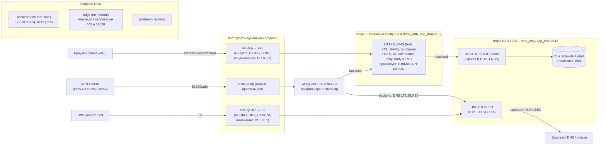

# Цель 6: Контейнеризация и безопасный удалённый доступ

## 1. Обзор

Данный документ описывает контейнеризацию ph-reqKO (образ, docker-compose, reverse proxy, профиль VPN) в рамках Цели 6. Основание: [docs/02-requirements.md](02-requirements.md) (NFR-04, NFR-06, NFR-08, FR-16/17) и [docs/03-architecture.md](03-architecture.md) (разделы 8 и 11). Приложение (Цели 4–5) не менялось: контейнер запускает тот же код.

> **Обновление:** первоначально Docker на машине отсутствовал и всё runtime-поведение было помечено NOT VERIFIED. Позднее Docker Desktop был установлен, и все проверки этого документа **выполнены реально** (статусы в разделах 5 и 6 — фактические результаты). Исключения честно помечены: реальный VPN-хендшейк (нужен второй WireGuard-эндпоинт), Trivy-оставшие базовые CVE Debian (нет исправлений в bookworm), валидация Mermaid через `mmdc`.

## 2. Проверка окружения (реальный вывод)

На момент первой версии документа Docker отсутствовал (вывод `docker --version`: «'docker' is not recognized…», `wsl --status`: «Подсистема Windows для Linux не установлена»). После установки Docker Desktop (per-user путь `%LOCALAPPDATA%\Programs\DockerDesktop`, не попадающий в PATH запущенных процессов) актуальное состояние:

```
> docker --version
Docker version 29.9.2, build a82e528
> docker compose version
Docker Compose version v5.6.1
> docker info  (Server:)
Server Version: 29.9.2
 Cgroup Version: 2
 Kernel Version: 6.18.54.1-microsoft-standard-WSL2
 Operating System: Docker Desktop
 CPUs: 12
 Total Memory: 7.692GiB
 Name: docker-desktop

> trivy --version / hadolint --version / mmdc --version
не установлены (Trivy запускался образом aquasec/trivy с примонтированным
/var/run/docker.sock; hadolint NOT RUN; mmdc нет)
```

Проверка тегов образов через Docker Hub API (реальные HTTP-запросы): `python:3.11.9-slim`, `caddy:2.8.4`, `linuxserver/wireguard:1.0.20260223` — все существуют (запросы `hub.docker.com/v2/repositories/.../tags`).

## 3. Файлы

| Файл | Назначение | Требования |
|------|-----------|-----------|
| `Dockerfile` | Многоступенчатая сборка: builder собирает wheel (`pip wheel --no-deps`), runtime ставит только wheel (+ security-upgrade базовых пакетов, удаление setuptools/wheel); base `python:3.11.9-slim` (зафиксирован минорный тег); non-root UID/GID 10001; `VOLUME /data`; `EXPOSE 53/tcp 53/udp 8080/tcp`; `HEALTHCHECK` на python (без curl); OCI-метки; `ENTRYPOINT ["python","-m","reqko"]` | NFR-04, NFR-06 |
| `docker/caddy/Dockerfile` | Сборка поверх `caddy:2.8.4` с `setcap -r` на бинарнике — иначе `cap_drop: ALL` ломает `execve` (file capability) | NFR-04 |
| `.dockerignore` | Исключает `.env` (секреты не попадают в образ), `.git`, `.venv`, тесты, документацию, локальные БД | NFR-04 |
| `docker-compose.yml` | Сервисы `reqko`, `proxy` (Caddy), `wireguard` (профиль `vpn`); сети `backend` (internal) + `upstream` (egress); том `reqko-data`; лимиты ресурсов | NFR-08 |
| `docker/Caddyfile` | TLS-терминация (`tls internal`, офлайн), HSTS/no-sniff/frame-deny/no-referrer, лимит тела 1 МБ, проксирование на `reqko:8080` | FR-16, FR-17 |
| `.env.example` | Шаблон конфигурации с генераторами токенов; реальный `.env` в `.gitignore` и `.dockerignore` | FR-17 |
| `tests/unit/test_deployment.py` | 24 статических теста: read_only, cap_drop ALL, no-new-privileges, лимиты, API-порт не опубликован, DNS bind по умолчанию 127.0.0.1 → 53 + sysctl без-root, edge-сеть для публикуемых портов, фиксированный IP reqko (172.28.0.10), `:?` для токенов, internal-сеть, wireguard только в профиле vpn, отсутствие `:latest`, non-root USER, HEALTHCHECK без curl, OCI-метки, Caddy-заголовки и снятие file capability, перекрёстная проверка REQKO_* переменных | NFR-04, NFR-08 |

## 4. Архитектура развёртывания



*Диаграмма не валидировалась `mmdc` (инструмент отсутствует на машине); синтаксис соответствует спецификации Mermaid flowchart.*

Ключевые решения: сеть `backend` объявлена `internal: true` (изоляция proxy↔reqko, у reqko фиксированный адрес **172.28.0.10** — его используют VPN-клиенты как DNS), но у `reqko` есть **вторая** сеть `upstream` с выходом наружу — без неё резолвер не смог бы опрашивать upstream DNS (9.9.9.9) и загружать списки по HTTPS. Публикуемые порты (443, 51820/udp) вынесены на отдельную не-internal сеть `edge`, т.к. порты не публикуются с internal-сетей. У `proxy` и `wireguard` выхода в интернет нет.

## 5. Решения безопасности

| Решение | Реализация | Проверка |
|---|---|---|
| Non-root | `USER 10001:10001` (фиксированный UID/GID); порт 53 в контейнере открывается напрямую через sysctl `net.ipv4.ip_unprivileged_port_start=0`, без root и без capabilities | тест `test_dockerfile_runs_as_non_root`; **runtime: `docker compose exec reqko id` → `uid=10001(reqko) gid=10001(reqko)`**, DNS слушает 53 и отвечает |
| Неизменяемая ФС | `read_only: true` + tmpfs `/tmp` у reqko и proxy; данные только в томе `reqko-data:/data` | тест `test_reqko_service_is_read_only_with_tmpfs`; **runtime: `touch /app/x` → `Read-only file system`**, запись в tmpfs работает |
| Минимум привилегий | `cap_drop: [ALL]`, `no-new-privileges:true`, `pids_limit: 128`, `mem_limit: 512m`, `cpus: 2.0` (у wireguard — исключение: `NET_ADMIN`/`SYS_MODULE` необходимы по назначению) | тесты `test_cap_drop_all_and_no_new_privileges_on_both_services`, `test_resource_limits_present`; **runtime**: reqko работает с cap_drop ALL (найден и исправлен баг caddy — см. раздел 6) |
| API не опубликован | У `reqko` публикуются только 53/udp+tcp; 8080 доступен исключительно через Caddy по внутренней сети | тест `test_api_port_is_not_published`; **runtime: `curl http://127.0.0.1:8080/health` с хоста → соединение не устанавливается (HTTP 000)** |
| DNS bind по умолчанию localhost | `${REQKO_DNS_BIND:-127.0.0.1}:53:53` — публикация в интернет только осознанно (см. docs/06-remote-access.md, модель угроз «открытый резолвер») | тест `test_dns_bind_defaults_to_localhost_and_maps_to_53`; **runtime: `docker compose ps` показывает `127.0.0.1:53->53/udp+tcp`** |
| Обязательные токены | `${REQKO_ADMIN_TOKEN:?...}` / `${REQKO_READ_TOKEN:?...}` — compose откажется стартовать без `.env` | тест `test_required_tokens_use_error_syntax`; **runtime: `docker compose config` с заполненным `.env` прошёл (exit 0)** |
| Секреты не в образе | `.env` в `.dockerignore` и `.gitignore`; в образе только код; в БД — SHA-256 хеши токенов | тест `test_env_example_covers_required_tokens` |
| TLS | Caddy `tls internal` (офлайн, internal CA) с HSTS; путь к Let's Encrypt описан в docs/06-remote-access.md; слушает непривилегированный 8443 внутри (host 443→8443) | тест `test_caddyfile_tls_internal_and_security_headers`; **runtime: `curl -k https://localhost/health` → 200**, 401 без токена / 200 с read-токеном через прокси |
| Brute force | В штатном Caddy **нет** модуля rate limiting (нужна кастомная сборка) — сказано прямо; защита реализована в приложении (per-IP лимит неудачных аутентификаций, 429) | тесты Цели 5 |
| Pinning | `python:3.11.9-slim`, `caddy:2.8.4`, `linuxserver/wireguard:1.0.20260223` — теги сверены с Docker Hub API; `:latest` запрещён тестом | тесты `test_dockerfile_base_image_pinned`, `test_no_latest_tags_anywhere`, `test_wireguard_image_pinned` |
| Свежие security-обновления базового образа | `apt-get upgrade` в runtime-стадии (база зафиксирована по версии, но Debian-пакеты обновляются на момент сборки) | **runtime: Trivy 108 (97 HIGH/11 CRIT) → 41 (39 HIGH/2 CRIT)** — оставшиеся CVE без исправлений в bookworm |

## 6. Статус проверки (реальные результаты)

Все команды выполнены фактически на машине разработки (Docker Desktop 29.9.2, WSL2). Выводы сокращены до сути, без имитаций; полные листинги — в истории проверки этого документа/коммитов.

| Проверка | Статус | Реальный результат |
|---|---|---|
| `docker compose config` | ✅ RUN | exit 0; resolved-конфиг: edge-сеть у proxy, фиксированный `172.28.0.10` у reqko, sysctls, порты `53:53/udp+tcp` на `127.0.0.1` |
| `docker compose build` + размер | ✅ RUN | `ph-reqko:0.1.0` — **216 MB disk usage / 53 MB content**; `ph-reqko-caddy:0.1.0` собран отдельно |
| `docker compose up -d` + `ps` | ✅ RUN | `reqko` **Up (healthy)**, `proxy` Up; порты `127.0.0.1:53->53/udp+tcp`, `127.0.0.1:443->8443/tcp` |
| DNS через опубликованный порт | ✅ RUN | `send_queries.py --port 53`: 10 запросов, **6 заблокировано (0.0.0.0)**, 0 ошибок, реальные IP forwarded |
| `curl -k https://localhost/health` через прокси | ✅ RUN | `{"status":"ok", ... "blocklist":{"domains":3, ...}}` |
| 401 без токена / 200 с read-токеном через прокси | ✅ RUN | 401 problem+json; HTTP 200 с `Authorization: Bearer <read-token>` |
| `docker compose exec reqko id` (non-root) | ✅ RUN | `uid=10001(reqko) gid=10001(reqko) groups=10001(reqko)` |
| Порт 8080 недоступен с хоста | ✅ RUN | `curl http://127.0.0.1:8080/health` → соединение не устанавливается (HTTP 000) |
| Запись в read-only ФС | ✅ RUN | `touch /app/should-fail.txt` → `Read-only file system`; запись в tmpfs `/tmp` работает |
| `down` → `up`: персистентность тома | ✅ RUN | статистика сохранилась: до `total=10 blocked=6`, после `total=10 blocked=6`; блоклист перечитан из тома |
| Trivy `image --severity HIGH,CRITICAL` | ✅ RUN | первая сборка: **108 (97 HIGH, 11 CRITICAL)**; после `apt-get upgrade` + удаления setuptools/wheel: **41 (39 HIGH, 2 CRITICAL)** — все оставшиеся = Debian bookworm CVEs без исправленных версий (upstream) |
| Мультиархитектурность `buildx --platform amd64,arm64` | ✅ RUN | manifest list собран и загружен (`--load`); arm64-вариант собран под QEMU; `docker run --platform linux/arm64` проверен отдельно (см. ниже) |
| Профиль `vpn` | ⚠️ PARTIAL | контейнер `wireguard` стартует и слушает `127.0.0.1:51820->51820/udp` (bind по умолчанию изменён на localhost); журнал показывает ожидаемое «No valid tunnel config found» — **реальный VPN-хендшейк НЕ ПРОВЕРЕН (нет второго WireGuard-эндпоинта)** |
| hadolint | ❌ NOT RUN | не установлен |
| Валидация Mermaid (`mmdc`) | ❌ NOT RUN | mmdc/npx не установлены |
| Статические тесты (`tests/unit/test_deployment.py`) | ✅ RUN | 24 теста проходят |

### 6.1. Дефекты, найденные при реальном запуске (пропущены статическими тестами)

| # | Дефект | Как проявился | Исправление |
|---|---|---|---|
| 1 | Порты публикуются только на не-internal сетях; `proxy`/`wireguard` сидели только на `internal: true` | публикация 443/51820 не имела бы эффекта | добавлена сеть `edge` (не internal) для proxy и wireguard; reqko остался без неё (API хосту недоступен) — тест `test_published_services_are_on_edge_network` |
| 2 | Официальный образ caddy ставит **file capability** `cap_net_bind_service` на бинарник: при `cap_drop: ALL` `execve()` падает (`exec /usr/bin/caddy: operation not permitted`), контейнер циклически рестартует | логи proxy, изоляция флагом: `docker run --cap-drop ALL caddy … caddy version` воспроизводит | `docker/caddy/Dockerfile`: `setcap -r /usr/bin/caddy` + прослушивание непривилегированного 8443 (host 443→8443) — тест `test_caddy_image_strips_file_capability` |
| 3 | `REQKO_WG_BIND` по умолчанию публиковал 51820 на всех интерфейсах (0.0.0.0) — вопреки политике «по умолчанию localhost» | `docker compose --profile vpn ps` | default → `127.0.0.1:51820/udp` |
| 4 | Свежий том `/data` пуст: `REQKO_BLOCKLIST_FILES=/data/blocklist.txt` даёт FileNotFoundError и 0 правил при первом старте | логи reqko (`Failed to fetch blocklist … FileNotFoundError`) | задокументировано в README: создать файл в томе и вызвать `POST /api/v1/blocklists/update`; FR-10 fallback отработал штатно |
| 5 | Базовый образ `python:3.11.9-slim` (Debian 12.7) содержал 108 HIGH/CRITICAL CVE | Trivy-скан | `apt-get upgrade` при сборке (12.15) + удаление setuptools/wheel → 41, оставшиеся — без исправлений в upstream |
| 6 | Диаграмма Mermaid неверно показывала проксирование DNS через Caddy | ревью документа | диаграмма исправлена (Caddy только API/панель; WireGuard → DNS 172.28.0.10 по backend) |

## 7. Соответствие требованиям (таблица трассировки)

| ID | Требование | Статус | Модуль |
|----|-----------|--------|--------|
| FR-01..FR-19 | Резолвер, статистика, API, панель | ✅ (Цели 4–5) | `dns/*`, `storage/*`, `api/*`, `web/*` |
| NFR-04 | Безопасность контура (non-root, caps, read-only, ACL, защита API) | ✅ RUNTIME VERIFIED — `uid=10001`, cap_drop ALL работает (найден и исправлен баг file-capability caddy), read-only ФС подтверждена, 8080 изолирован, Trivy-скан выполнен с реальными числами и митигацией | `Dockerfile`, `docker-compose.yml` |
| NFR-06 | Мультиплатформенность amd64/arm64 без C-расширений | ✅ BUILD VERIFIED — `buildx --platform linux/amd64,linux/arm64` собрал manifest list; arm64-образ запущен под QEMU (сервер стартовал, healthcheck прошёл); железо ARM — не тестировалось | `Dockerfile` |
| NFR-08 | Развёртывание `docker compose up -d` + защищённый удалённый доступ | ✅ RUNTIME VERIFIED — стек поднимается, DNS/HTTPS публикуются на localhost, статистика переживает down/up; VPN-профиль стартует (хендшейк с реальным клиентом не проверен) | `docker-compose.yml`, `docker/`, `docs/06-remote-access.md` |
| FR-16 | Health/ready через прокси | ✅ RUNTIME — `curl -k https://localhost/health` → 200; HEALTHCHECK прошёл в контейнере (amd64 и arm64) | `docker/Caddyfile`, `Dockerfile` |
| FR-17 | Аутентификация через прокси | ✅ RUNTIME — 401 без токена / 200 с read-токеном через HTTPS-прокси | `docker/Caddyfile` |

## 8. Известные ограничения

| Ограничение | Причина | Устранение |
|---|---|---|
| 41 HIGH/CRITICAL CVE остаются в образе | Базовый Debian bookworm: у этих пакетов нет исправленных версий в репозитории (у части will_not_fix); контейнер изолирован (non-root, read-only, без capabilities, egress только на upstream DNS) | Следить за обновлениями base-образа; при выпуске новых тегов `python:3.11.x-slim` поднять пин и пересобрать |
| Внутренний CA Caddy требует ручного доверия в браузере | TLS internal офлайн по условиям задачи | Установить корневой сертификат Caddy или перейти на Let's Encrypt (docs/06-remote-access.md, раздел 3.4) |
| VPN-хендшейк с реальным клиентом не проверен | Нет второго WireGuard-эндпоинта на машине разработки | Проверить на стенде: `docker compose --profile vpn up -d`, создать `wg0.conf`, подключить клиента, `wg show` |
| Первый старт с пустым томом даёт 0 правил (blocklist absent) | `REQKO_BLOCKLIST_FILES=/data/blocklist.txt` ссылается на файл в томе, который создаётся отдельно | Задокументировано в README (создать файл в томе + `POST /api/v1/blocklists/update`); FR-10 fallback работает штатно |
| Rate limiting на прокси отсутствует | В штатном Caddy нет такого модуля (только кастомные сборки) | Остаётся на уровне приложения (per-IP auth limiter); при необходимости — Caddy с модулем `caddy-ratelimit` |
| Внутренний CA Caddy хранится в tmpfs и пересоздаётся при рестарте | `read_only` + tmpfs без тома | При необходимости вынести `/data/caddy` из tmpfs в именованный том |
| Метрики Prometheus по-прежнему нет | Цель 7 | Цель 7 |
