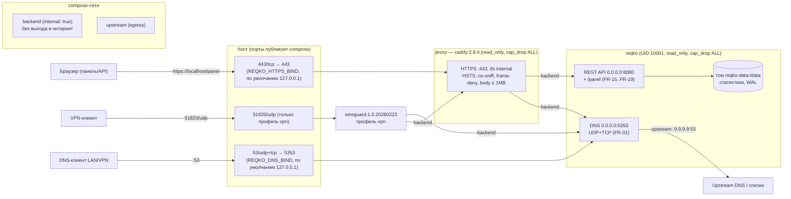

# Цель 6: Контейнеризация и безопасный удалённый доступ

## 1. Обзор

Данный документ описывает контейнеризацию ph-reqKO (образ, docker-compose, reverse proxy, профиль VPN) в рамках Цели 6. Основание: [docs/02-requirements.md](02-requirements.md) (NFR-04, NFR-06, NFR-08, FR-16/17) и [docs/03-architecture.md](03-architecture.md) (разделы 8 и 11). Приложение (Цели 4–5) не менялось: контейнер запускает тот же код.

> **Главное ограничение этого документа:** на машине разработки **Docker недоступен** — `docker`, `docker compose`, `trivy`, `hadolint` отсутствуют, Docker Desktop не установлен, Podman отсутствует, `wsl --status` сообщает «Подсистема Windows для Linux не установлена». Все команды сборки и запуска поэтому **НЕ ВЫПОЛНЯЛИСЬ** (NOT VERIFIED). Выполнена только статическая проверка: YAML-парсинг compose, 21 тест безопасности конфигураций (`tests/unit/test_deployment.py`), перекрёстная проверка переменных окружения, теги образов сверены с реальными данными Docker Hub API (через HTTP — сеть доступна). Никакие выводы docker не имитировались.

## 2. Проверка окружения (реальный вывод)

```
> docker --version
'docker' is not recognized as an internal or external command
> docker compose version
'docker' is not recognized as an internal or external command
> trivy --version
'trivy' is not recognized as an internal or external command
> hadolint --version
'hadolint' is not recognized as an internal or external command
> wsl --status
Подсистема Windows для Linux не установлена. Для установки выполните команду "wsl.exe --install".
> docker compose config / docker build / trivy image ...
NOT RUN (Docker недоступен)
> mmdc --version (валидация Mermaid)
mmdc и npx не найдены — диаграммы не валидировались CLI
```

Также проверены пути установки Docker Desktop и Podman — отсутствуют. Проверка тегов образов через Docker Hub API (реальные HTTP-запросы): `python:3.11.9-slim`, `caddy:2.8.4`, `linuxserver/wireguard:1.0.20260223` — все существуют (проверено запросами `hub.docker.com/v2/repositories/.../tags`).

## 3. Файлы

| Файл | Назначение | Требования |
|------|-----------|-----------|
| `Dockerfile` | Многоступенчатая сборка: builder собирает wheel (`pip wheel --no-deps`), runtime ставит только wheel; base `python:3.11.9-slim` (зафиксирован минорный тег); non-root UID/GID 10001; `VOLUME /data`; `EXPOSE 5353/tcp 5353/udp 8080/tcp`; `HEALTHCHECK` на python (без curl); OCI-метки; `ENTRYPOINT ["python","-m","reqko"]` | NFR-04, NFR-06 |
| `.dockerignore` | Исключает `.env` (секреты не попадают в образ), `.git`, `.venv`, тесты, документацию, локальные БД | NFR-04 |
| `docker-compose.yml` | Сервисы `reqko`, `proxy` (Caddy), `wireguard` (профиль `vpn`); сети `backend` (internal) + `upstream` (egress); том `reqko-data`; лимиты ресурсов | NFR-08 |
| `docker/Caddyfile` | TLS-терминация (`tls internal`, офлайн), HSTS/no-sniff/frame-deny/no-referrer, лимит тела 1 МБ, проксирование на `reqko:8080` | FR-16, FR-17 |
| `.env.example` | Шаблон конфигурации с генераторами токенов; реальный `.env` в `.gitignore` и `.dockerignore` | FR-17 |
| `tests/unit/test_deployment.py` | 21 статический тест: read_only, cap_drop ALL, no-new-privileges, лимиты, API-порт не опубликован, DNS bind по умолчанию 127.0.0.1 → 5353, `:?` для токенов, internal-сеть, wireguard только в профиле vpn, отсутствие `:latest`, non-root USER, HEALTHCHECK без curl, OCI-метки, Caddy-заголовки, перекрёстная проверка REQKO_* переменных | NFR-04, NFR-08 |

## 4. Архитектура развёртывания



*Диаграмма не валидировалась `mmdc` (инструмент отсутствует на машине); синтаксис соответствует спецификации Mermaid flowchart.*

Ключевое решение: сеть `backend` объявлена `internal: true` (изоляция proxy↔reqko), но у `reqko` есть **вторая** сеть `upstream` с выходом наружу — без неё резолвер не смог бы опрашивать upstream DNS (9.9.9.9) и загружать списки по HTTPS. У `proxy` и `wireguard` доступа в интернет нет.

## 5. Решения безопасности

| Решение | Реализация | Проверка |
|---|---|---|
| Non-root | `USER 10001:10001` (фиксированный UID/GID), DNS на 5353 внутри контейнера → 53 снаружи, привилегий не нужно | тест `test_dockerfile_runs_as_non_root`; runtime `docker compose exec reqko id` — NOT VERIFIED |
| Неизменяемая ФС | `read_only: true` + tmpfs `/tmp` у reqko и proxy; данные только в томе `reqko-data:/data` | тест `test_reqko_service_is_read_only_with_tmpfs`; runtime — NOT VERIFIED |
| Минимум привилегий | `cap_drop: [ALL]`, `no-new-privileges:true`, `pids_limit: 128`, `mem_limit: 512m`, `cpus: 2.0` (у wireguard — исключение: `NET_ADMIN`/`SYS_MODULE` необходимы по назначению) | тесты `test_cap_drop_all_and_no_new_privileges_on_both_services`, `test_resource_limits_present` |
| API не опубликован | У `reqko` публикуются только 53/udp+tcp; 8080 доступен исключительно через Caddy по внутренней сети | тест `test_api_port_is_not_published` |
| DNS bind по умолчанию localhost | `${REQKO_DNS_BIND:-127.0.0.1}:53:5353` — публикация в интернет только осознанно (см. docs/06-remote-access.md, модель угроз «открытый резолвер») | тест `test_dns_bind_defaults_to_localhost_and_maps_to_5353` |
| Обязательные токены | `${REQKO_ADMIN_TOKEN:?...}` / `${REQKO_READ_TOKEN:?...}` — compose откажется стартовать без `.env` | тест `test_required_tokens_use_error_syntax` |
| Секреты не в образе | `.env` в `.dockerignore` и `.gitignore`; в образе только код; в БД — SHA-256 хеши токенов | тест `test_env_example_covers_required_tokens` |
| TLS | Caddy `tls internal` (офлайн, internal CA) с HSTS; путь к Let's Encrypt описан в docs/06-remote-access.md | тест `test_caddyfile_tls_internal_and_security_headers`; TLS-хендшейк — NOT VERIFIED |
| Brute force | В штатном Caddy **нет** модуля rate limiting (нужна кастомная сборка) — сказано прямо; защита реализована в приложении (per-IP лимит неудачных аутентификаций, 429) | тесты Цели 5 |
| Pinning | `python:3.11.9-slim`, `caddy:2.8.4`, `linuxserver/wireguard:1.0.20260223` — теги сверены с Docker Hub API; `:latest` запрещён тестом | тесты `test_dockerfile_base_image_pinned`, `test_no_latest_tags_anywhere`, `test_wireguard_image_pinned` |

## 6. Статус проверки (честно)

| Проверка | Статус |
|---|---|
| `docker compose config` | ❌ NOT RUN (Docker отсутствует) |
| `docker build` + размер образа | ❌ NOT RUN |
| `docker compose up -d`, `ps` (healthy), send_queries через 53, `curl -k https://localhost/health`, 401/200 через прокси | ❌ NOT RUN |
| `docker compose exec reqko id` (non-root), попытка записи в read-only ФС | ❌ NOT RUN |
| Публикация API-порта закрыта (скан с хоста) | ❌ NOT RUN |
| `docker compose down && up` — персистентность статистики в томе | ❌ NOT RUN |
| `trivy image --severity HIGH,CRITICAL` | ❌ NOT RUN (trivy отсутствует; `docker run aquasec/trivy` тоже невозможен без Docker) |
| `hadolint` Dockerfile | ❌ NOT RUN (не установлен) |
| `docker buildx build --platform linux/amd64,linux/arm64` | ❌ NOT RUN (buildx недоступен; мультиархитектурность обеспечена чистым Python без C-расширений) |
| YAML-парсинг compose + 21 статический тест безопасности | ✅ пройдены (pytest) |
| Перекрёстная проверка REQKO_* (compose ↔ config.py) | ✅ пройдена |
| Теги образов сверены с Docker Hub API | ✅ пройдена |
| Профиль `vpn` (WireGuard), генерация peer-конфигураций | ❌ NOT VERIFIED (см. docs/06-remote-access.md) |

## 7. Соответствие требованиям (таблица трассировки)

| ID | Требование | Статус | Модуль |
|----|-----------|--------|--------|
| FR-01..FR-19 | Резолвер, статистика, API, панель | ✅ (Цели 4–5) | `dns/*`, `storage/*`, `api/*`, `web/*` |
| NFR-04 | Безопасность контура (non-root, caps, non-root контейнер, ACL, защита API) | ⚠️ PARTIAL — конфигурация полная и покрыта тестами; runtime-проверки и Trivy-скан NOT VERIFIED | `Dockerfile`, `docker-compose.yml` |
| NFR-06 | Мультиплатформенность amd64/arm64 без C-расширений | ⚠️ PARTIAL — чистый Python, теги `python:3.11.9-slim` существуют для обеих архитектур; сборка buildx NOT VERIFIED | `Dockerfile` |
| NFR-08 | Развёртывание `docker compose up -d` + защищённый удалённый доступ | ⚠️ PARTIAL — compose, .env.example, Caddy (TLS internal), профиль vpn и документация готовы; запуск `up -d` и VPN NOT VERIFIED | `docker-compose.yml`, `docker/`, `docs/06-remote-access.md` |
| FR-16 | Health/ready через прокси | ✅ конфигурация (`/health`, `/ready` проксируются; HEALTHCHECK в образе); runtime NOT VERIFIED | `docker/Caddyfile`, `Dockerfile` |
| FR-17 | Аутентификация через прокси | ✅ конфигурация (HTTPS + Bearer на приложении); runtime NOT VERIFIED | `docker/Caddyfile` |

## 8. Известные ограничения

| Ограничение | Причина | Устранение |
|---|---|---|
| Всё runtime-поведение контейнера NOT VERIFIED | Docker/WSL не установлены на машине разработки | Установить Docker Desktop (или Docker Engine в WSL2) и выполнить чек-лист раздела 6 из этого документа |
| Внутренний CA Caddy требует ручного доверия в браузере | TLS internal офлайн по условиям задачи | Установить корневой сертификат Caddy (`docker compose exec proxy cat /data/caddy/pki/authorities/local/root.crt`) или перейти на Let's Encrypt (docs/06-remote-access.md, раздел 3.4) |
| Rate limiting на прокси отсутствует | В штатном Caddy нет такого модуля (только кастомные сборки) | Остаётся на уровне приложения (per-IP auth limiter); при необходимости — Caddy с модулем `caddy-ratelimit` |
| Trivy-скан не выполнен | Нет Docker и trivy | `trivy image ph-reqko:0.1.0 --severity HIGH,CRITICAL` после первой сборки |
| Метрики Prometheus по-прежнему нет | Цель 7 | Цель 7 |
