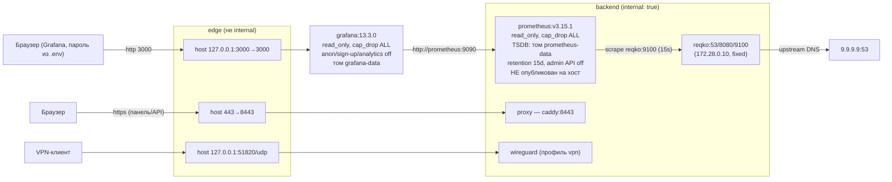

# Цель 7: Мониторинг (Prometheus/Grafana) и CI

## 1. Обзор

Данный документ описывает реализацию экспорта метрик Prometheus (NFR-07), провижинированного стека мониторинга (Prometheus + Grafana в compose) и автоматизированного CI (NFR-09). Приложение Цели 4–5 расширено минимально: экспортёр метрик — отдельный aiohttp-сайт, горячий путь DNS не изменён по семантике.

Проверено на реальной машине: Windows 11 x64, Docker Desktop 29.9.2 (WSL2), Docker Compose v5.6.1. Данные для NFR-01/02 собраны метриками; их валидация на целевом стенде — Цель 8.

## 2. Проверка окружения (реальный вывод)

```
> docker --version
Docker version 29.9.2, build a82e528
> docker compose version
Docker Compose version v5.6.1
> docker info (Server:)
Server Version: 29.9.2 / Operating System: Docker Desktop / WSL2
> trivy / hadolint / mmdc
trivy запускался образом aquasec/trivy (смонтирован /var/run/docker.sock);
hadolint и mmdc не установлены (NOT RUN)
```

Теги образов сверены с Docker Hub API (реальные запросы): `prom/prometheus:v3.15.1` и `grafana/grafana:13.3.0` существуют; `:latest` не используется.

## 3. Файлы

| Файл | Назначение | Требования |
|------|-----------|-----------|
| `src/reqko/metrics/exporter.py` | Реестр метрик (O(1) обновления) + отдельный aiohttp-сайт `GET /metrics` с ACL-проверкой клиента (403 вне `REQKO_ALLOWED_NETWORKS`) | NFR-07, NFR-03 |
| `src/reqko/dns/pipeline.py` | Точки съёма метрик в конвейере через `_record()` — обёртка, которая глотает любые исключения (метрики не могут влиять на резолвинг) | NFR-03, NFR-07 |
| `src/reqko/dns/server.py` | UDP/TCP-обработчики передают `protocol="udp"/"tcp"` в конвейер (метка protocol) | NFR-07 |
| `src/reqko/filtering/rules.py` | Callback `on_rules_changed` после каждой атомарной подмены снимка → gauge `dns_active_rules_count` | NFR-07 |
| `src/reqko/__main__.py` | Запуск сайта метрик на `REQKO_METRICS_HOST:REQKO_METRICS_PORT` (отдельный AppRunner); сбой сайта не останавливает резолвинг | NFR-07, NFR-03 |
| `docker/prometheus/prometheus.yml` | Конфиг Prometheus: scrape `reqko:9100` по внутреннему backend-网络的 имени сервиса | NFR-07 |
| `docker/grafana/provisioning/**` | Провижининг datasource (uid `prometheus`, url `http://prometheus:9090`) и дашборда — без ручных шагов в UI | NFR-07 |
| `docker/grafana/dashboards/reqko.json` | Дашборд «ph-reqKO overview» (uid `reqko-overview`, 11 панелей) | NFR-07 |
| `docker-compose.yml` | Сервисы `prometheus` (backend only, не опубликован) и `grafana` (backend+edge, опубликован только на loopback) | NFR-08 |
| `.github/workflows/ci.yml` | CI: ruff, mypy strict, pytest с порогом покрытия 70%, docker build, Trivy (fail только на исправляемые HIGH/CRITICAL), buildx-матрица amd64/arm64 | NFR-09 |
| `tests/unit/test_metrics.py` | 14 тестов: формат экспозиции, инкременты по событиям, ACL 403/200, изоляция горячего пути, кардинальность | NFR-07, NFR-03 |
| `tests/unit/test_deployment.py` | +10 тестов: пиннинг образов, харденинг, 9100 не опубликован, провижининг существует и парсится, дашборд валиден и ссылается только на определённые экспортёром метрики | NFR-08 |
| `docs/evidence/07-runtime.txt` | Полные листинги runtime-проверок | — |

## 4. Выбор: экспозиция написана вручную (без prometheus_client)

NFR-06 запрещает обязательные C-расширения. `prometheus_client` — чистый Python, то есть формально допустим; выбор в пользу ручной реализации обоснован так:

1. Проекту нужно ровно 8 семейств метрик; библиотека добавила бы зависимость и API-слой, который всё равно пришлось бы оборачивать ради NFR-03;
2. Ручные счётчики — это инкременты `dict` и списки: O(1), без I/O, тривиально доказуемая неблокируемость (тест `_RaisingRegistry` + `test_resolver_answers_when_registry_raises`);
3. Формат `text/plain; version=0.0.4` для counter/gauge/histogram компактен и стабилен; гистограмма с фиксированными buckets `0.0005s…5s` покрывает требования «суб-миллисекунда…секунды»;
4. Кардинальность контролируется структурно: qtype схлопывается в `OTHER`, классы запроса — фиксированное множество, домены и IP клиента в метки не попадают (тест `test_no_high_cardinality_labels_in_render`).

## 5. Метрики (NFR-07)

| Метрика | Тип | Метки | Событие |
|---|---|---|---|
| `dns_queries_total` | counter | `protocol="udp\|tcp"`, `qtype` (известные + `OTHER`) | разобранный запрос (после wire parse) |
| `dns_blocked_queries_total` | counter | `reason="blacklist\|cname"` | любой блокирующий ответ (4 точки конвейера) |
| `dns_query_duration_seconds` | histogram | `class="cache\|blocked\|upstream\|error"` | завершение обработки соответствующего класса |
| `dns_cache_hits_total` / `dns_cache_misses_total` | counter | — | попадание в кеш / промах (уход на upstream) |
| `dns_active_rules_count` | gauge | — | каждая атомарная подмена снимка правил |
| `dns_dropped_logs_total` | counter | — | переполнение очереди журнала (NFR-03) |
| `process_resident_memory_bytes` | gauge | — | чтение `/proc/self/status` при скрейпе (Linux; на Windows метрика опускается) |

Реальный срез экспозиции (после 20 запросов, из `docs/evidence/07-runtime.txt`):

```
dns_queries_total{protocol="udp",qtype="A"} 20
dns_blocked_queries_total{reason="blacklist"} 12
dns_query_duration_seconds_count{class="cache"} 5
dns_query_duration_seconds_count{class="blocked"} 12
dns_query_duration_seconds_count{class="upstream"} 3
dns_cache_hits_total 5
dns_cache_misses_total 3
dns_active_rules_count 77760
dns_dropped_logs_total 0
```

## 6. Архитектура мониторинга



*Диаграмма не валидировалась `mmdc` (инструмент отсутствует).*

Сетевые решения: Prometheus сидит **только на backend** (internal) и не публикуется — до `/metrics` нельзя добраться с хоста; Grafana требует публикуемый порт и поэтому подключена к `edge` (не internal) — **честно**: Grafana технически имеет egress через `edge`, ограничивается её собственным хардненингом (read_only, cap_drop ALL, пароль, anonymous/sign-up off).

## 7. Статус проверки (реальные результаты)

Полные листинги — [docs/evidence/07-runtime.txt](evidence/07-runtime.txt).

| Проверка | Статус | Результат |
|---|---|---|
| `docker compose config` | ✅ RUN | exit 0; `:?` для `GRAFANA_ADMIN_PASSWORD` реально сработал до добавления ключа в `.env` |
| `up -d` + `ps` | ✅ RUN | 4 контейнера: reqko **Up (healthy)**, proxy Up, prometheus Up, grafana Up |
| `GET /metrics` изнутри backend | ✅ RUN | HTTP 200, 5079 байт; реальные значения счётчиков и гистограмм |
| 9100 недоступен с хоста | ✅ RUN | `curl http://127.0.0.1:9100/metrics` → HTTP 000 (соединение не устанавливается) |
| ACL на /metrics (403 вне сетей) | ✅ UNIT | живой 403 из публичного диапазона невоспроизводим на приватных docker-сетях — проверено тестом `test_metrics_site_acl_403_for_outside_client` |
| Промetheus target | ✅ RUN | `http://reqko:9100/metrics | health: up` |
| Все 15 PromQL-выражений дашборда через API | ✅ RUN | `expressions with empty/failed results: 0` (p50/p95/p99 по 4 классам = 4 серии) |
| Grafana `/api/health` | ✅ RUN | `{"database": "ok", "version": "13.3.0"}` |
| Grafana 401 без кредов | ✅ RUN | `HTTP_STATUS=401` |
| Grafana login + `/api/datasources` + `/api/search` + dashboard по uid | ✅ RUN | datasource `Prometheus → http://prometheus:9090`; дашборд `reqko-overview`, 11 панелей |
| Non-root id новых сервисов | ✅ RUN | prometheus `uid=65534(nobody)`, grafana `uid=472(grafana)` |
| read-only ФС новых сервисов | ✅ RUN | `touch`: `Read-only file system` (обе) |
| Персистентность после `down`/`up` | ✅ RUN | все 4 контейнера поднялись; блоклист перезагружен (77760 правил); метрика `dns_blocked_queries_total 12` сохранила историю в TSDB |
| Trivy `prom/prometheus:v3.15.1` | ✅ RUN | **0 HIGH/CRITICAL** (distroless: только gobinary-таргеты, чистые) |
| Trivy `grafana/grafana:13.3.0` | ✅ RUN | alpine 3.24.3: 0 OS-CVE; **5 HIGH, 0 CRITICAL** в library-таргетах (Go/node зависимости, часть с available fix) |
| Trivy `ph-reqko:0.1.0` (повторно) | ✅ RUN | 41 (39 HIGH/2 CRIT) — без изменений, все unfixed upstream |
| Trivy `ph-reqko:ci` (цель 8, обновлённый образ) | ✅ RUN | **0 HIGH/CRITICAL, exit 0** при политике CI (`--severity HIGH,CRITICAL --ignore-unfixed`); происхождение и разрешение единственной находки (pip-SBOM, setuptools 70.3.0) — `docs/evidence/08-trivy-origin.txt`, `docs/08-testing-and-conclusions.md` §3.3 |
| Регрессия Цели 6: health через прокси, 401, DNS на 53 | ✅ RUN | health ok (77760 правил), 401 без токена, 10/10 DNS-запросов (6 blocked) |
| Рендер Grafana UI глазами | ❌ NOT VERIFIED | визуальная проверка в браузере за пользователем |
| CI на GitHub | ❌ NOT RUN | пуш запрещён правилами; workflow валидирован actionlint локально |
| `mmdc`-валидация диаграммы | ❌ NOT RUN | инструмент отсутствует |

### 7.1. Дефекты, найденные при реальном запуске (пропущены статическими тестами)

| # | Дефект | Как проявился | Исправление |
|---|---|---|---|
| 1 | Prometheus v3 не принимает `--flag=false` (`Error parsing command line arguments: unexpected false`), контейнер циклически рестартовал | логи prometheus; бисекция `docker run prom/prometheus:v3.15.1 --web.enable-admin-api=false` | флаги убраны: в v3 admin API/lifecycle выключены по умолчанию (`--[no-]` форма в help); тест изменён на запрет обоих флагов |
| 2 | `REQKO_METRICS_HOST` не был задан в compose → сайт метрик слушал 127.0.0.1 внутри контейнера → Prometheus target DOWN (`connect: connection refused`) | `up{job="reqko"} = 0` / lastError в `/api/v1/targets` | compose: `REQKO_METRICS_HOST: 0.0.0.0` + тест `test_metrics_not_published_by_reqko` проверяет и bind, и отсутствие публикации |
| 3 | Свежий том `/data` без blocklist (известное ограничение Цели 6) подтверждено снова | логи reqko первого старта | документировано в README (создать файл в томе + POST update) |
| 4 | `pip >= 26` поставляет `pip/_vendor/bom.cdx.json` — CycloneDX-SBOM своих build-time зависимостей (`setuptools==70.3.0`); Trivy-анализатор SBOM принимает её за установленный пакет → CI-скан падал на CVE-2025-47273, которого в ФС образа нет | извлечение слоя 8 (`docker save`), grep по литералу `70.3.0`: только `bom.cdx.json` и `vendor.txt`; `pip/_vendor` не содержит setuptools-кода (705 записей); установленный setuptools — 84.2.1 | runtime-стадия удаляет `bom.cdx.json` (pip его не читает); rescan: **0 findings, exit 0**; evidence `08-trivy-origin.txt` |

## 8. Соответствие требованиям

| ID | Требование | Статус |
|----|-----------|--------|
| NFR-07 | Метрики Prometheus (`/metrics`, имена из раздела 8 архитектуры) + Grafana дашборд | ✅ RUNTIME VERIFIED — экспортёр, scrape UP, дашборд провижинирован; UI-рендер — за пользователем |
| NFR-09 | Покрытие > 70% и CI | ⚠️ PARTIAL — покрытие 87% (порог 70% в CI), workflow написан и валидирован actionlint; **на GitHub NOT RUN** (пуш запрещён) |
| NFR-01 | Задержка p95 < 10–15 мс (кеш) | ⚠️ ДАННЫЕ СОБРАНЫ — гистограмма `dns_query_duration_seconds{class="cache"}` и панель p50/p95/p99 в дашборде; валидация значений — Цель 8 |
| NFR-02 | RAM < 200–350 МБ при 100k+ правил | ⚠️ ДАННЫЕ СОБРАНЫ — `process_resident_memory_bytes` (панель Resident memory) и реальное измерение 77760 правил; пороговые значения — Цель 8 |
| FR-16 | Health endpoints | ✅ (Цели 5–6, без регрессий) |

## 9. Известные ограничения

| Ограничение | Причина | Устранение |
|---|---|---|
| Docker Desktop NAT скрывает реальные IP клиентов | Контейнер видит NAT-адрес сети Docker, а не LAN-IP | `network_mode: host` (только Linux) или macvlan — зафиксировано при деплое на целевой стенд |
| UI Grafana не проверен визуально | Автоматизация ограничена API-проверками | Пользователь открывает `http://127.0.0.1:3000`, admin / `GRAFANA_ADMIN_PASSWORD` |
| CI не запускался на GitHub | Пуш запрещён правилами работы | Первый push ветки активирует workflow |
| Нет alerting-правил | Не входит в скоуп задачи | Alertmanager + правила добавляются в `docker/prometheus/` при необходимости |
| 41 базовых CVE в образе reqko (без upstream-фиксов) | Debian bookworm | Отслеживать обновления base-образа (см. docs/06-implementation.md) |
| `process_resident_memory_bytes` только на Linux | Чтение `/proc/self/status`; psutil недопустим (зависимость) | На Windows метрика опускается (тест фиксирует это поведение) |
